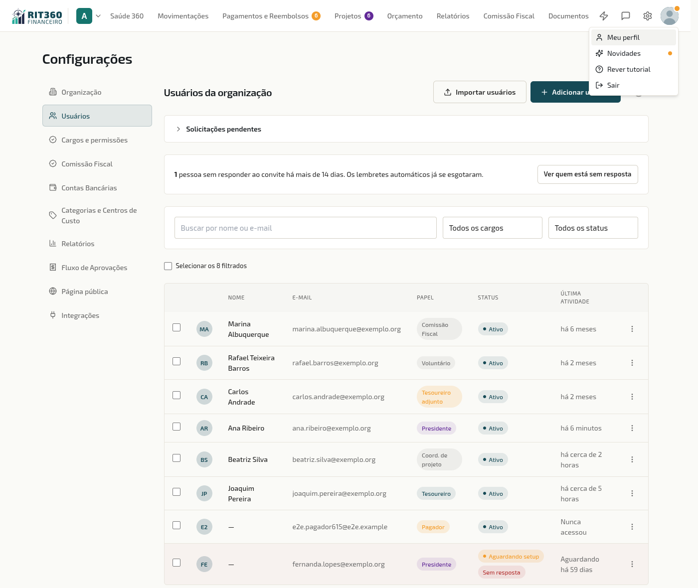
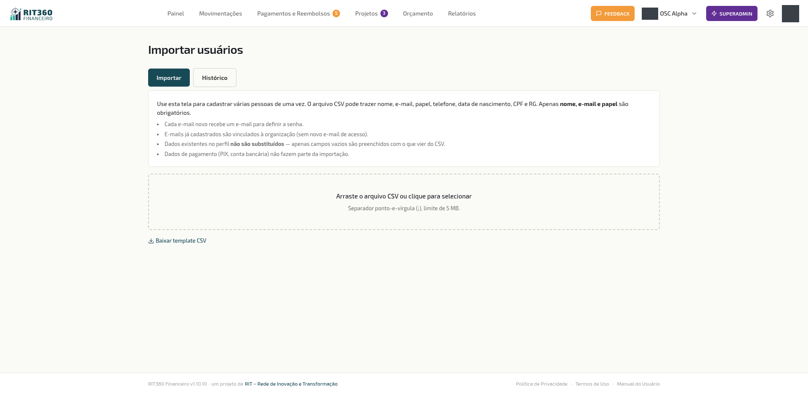
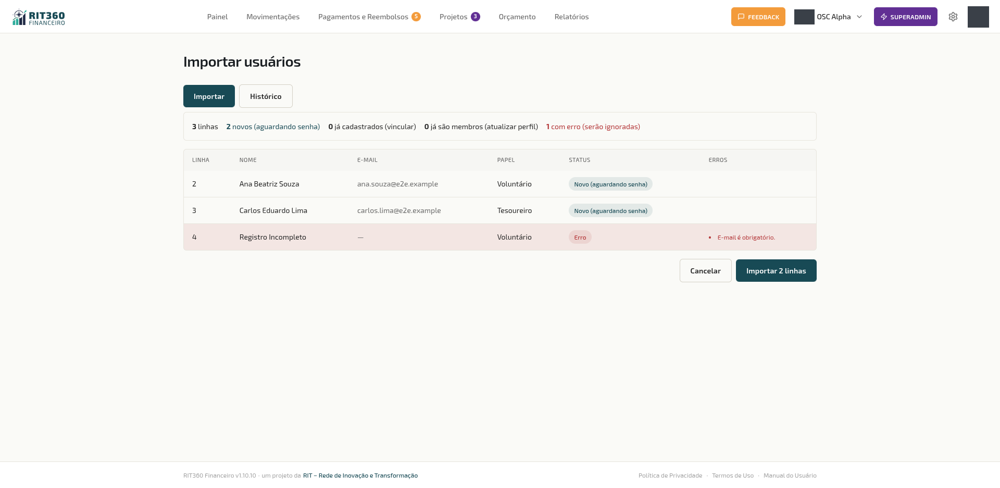
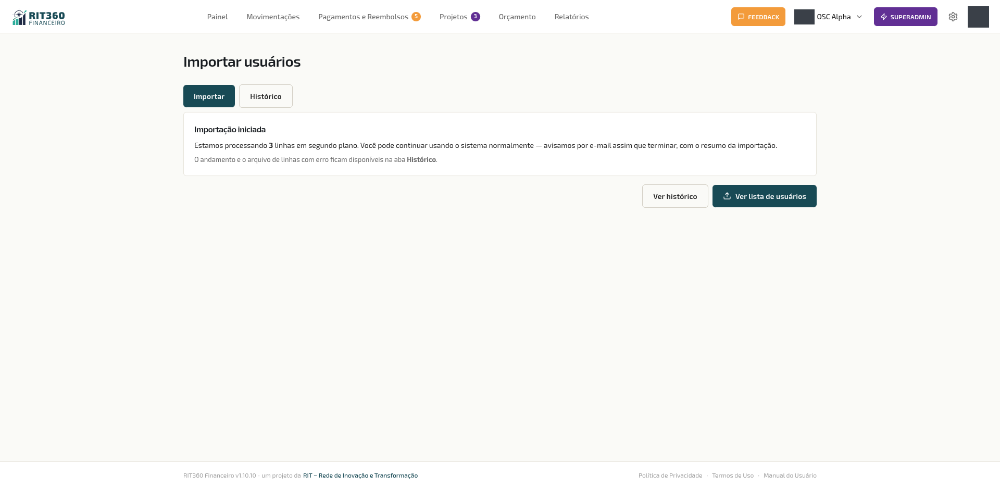
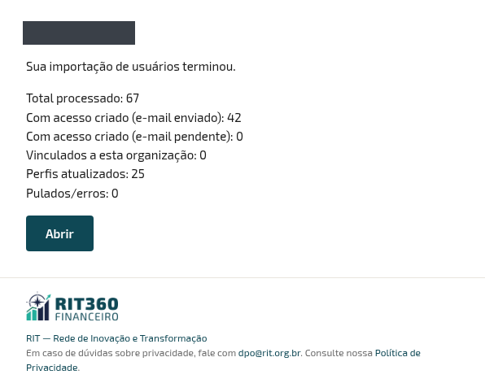
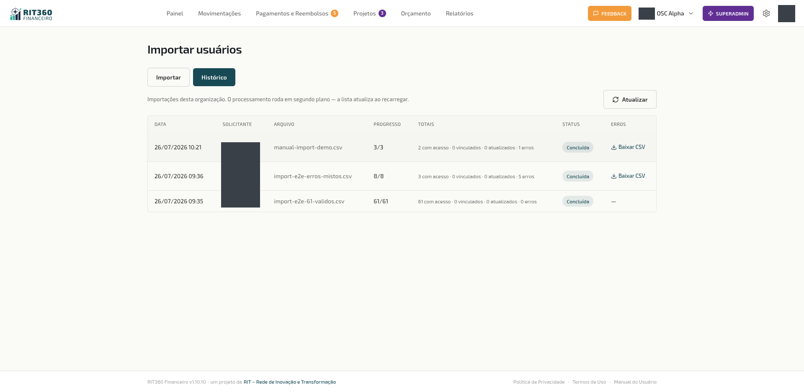
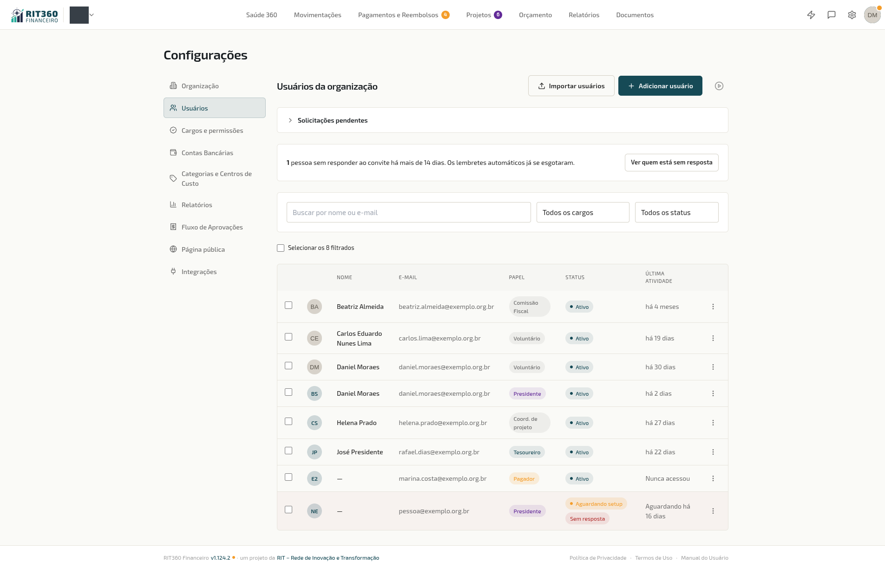
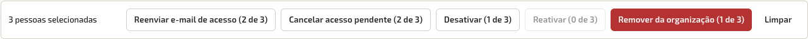
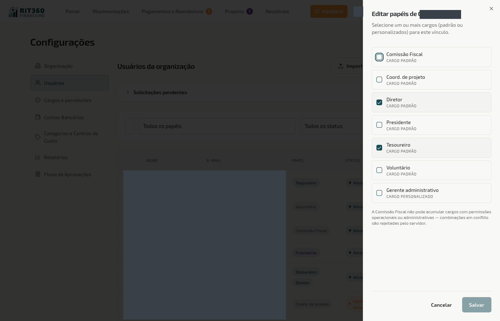
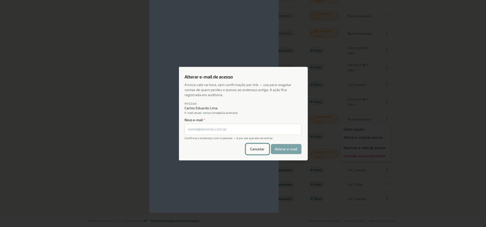

> Disponível para **Presidente (admin)**.

A página **Usuários** é onde você gerencia quem tem acesso à sua OSC dentro do RIT360 Financeiro — convidar novos membros, alterar papéis, suspender acessos.

*Configurações — Gerenciamento de usuários*

> 💡 **Por que isso importa**
>
> A pessoa errada com permissão errada é o caminho mais curto para um problema sério em OSC. Acesso administrativo dado para alguém que não devia, papel de aprovador para quem não tem mandato, voluntário recém-saído que ainda tem acesso meses depois — todos os casos derivam de gestão de usuários frouxa. Esta página é o ponto onde você mantém **quem entra, quem sai e quem pode o quê**.

> 🎥 **Vídeo tutorial · Convidar alguém e definir o que essa pessoa faz**
>
> Esta tela tem um vídeo curto (sem áudio, com legendas) sobre como adicionar pessoas e escolher o cargo de cada uma — clique no ícone de vídeo, no canto direito do cabeçalho. O mesmo vídeo também aparece em [Cargos e permissões](/configuracoes/cargos/). Veja todos os vídeos disponíveis em [Vídeos tutoriais dentro do app](/primeiros-passos/#videos-tutoriais).

Listagem traz todos os membros da OSC com nome, e-mail, papel, status (ativo/pendente/inativo) e foto de perfil. Quem foi incluído mas ainda não respondeu à inclusão aparece só com o e-mail — veja [Quem já usa o sistema](#aguardando-confirmacao).

## Adicionar usuário

Clique em **+ Adicionar usuário**. Informe o **nome completo**, o **e-mail** e o **papel** desejado — ao escolher **Presidente**, a tela avisa que a pessoa terá acesso total à organização. A tela **responde na hora**, assim que o cadastro é salvo — o e-mail é enviado em segundo plano. O status do usuário fica como "Pendente" até ele aceitar. Se o envio do e-mail falhar, o registro da falha fica guardado e o convite pode ser **reenviado** normalmente (ver Ações por membro).

O e-mail que a pessoa recebe depende de ela já usar o sistema ou não:

- **Pessoa nova** (nunca usou o RIT360 Financeiro): recebe o e-mail com o link de primeiro acesso, para definir a senha.
- **Pessoa que já tem conta** (por usar outra OSC): recebe um e-mail pedindo que entre com a conta de sempre e **responda se reconhece a inclusão**. Até responder, ela aparece na sua lista como **"Aguardando confirmação"** — veja [Quem já usa o sistema](#aguardando-confirmacao).

> ⚠️ **Se a tela recusar o cadastro**
>
> - *"Este e-mail já é membro da organização."* — a pessoa já está na lista, ativa, aguardando o primeiro acesso ou **inativa**. Procure o nome ou o e-mail na lista: se ela está **inativa**, use **Reativar acesso**; se ainda não entrou, use **Reenviar e-mail de acesso**. Cadastrar de novo não resolve.
> - *"Esta pessoa recusou o convite recentemente."* — ela respondeu **Não reconheço** há menos de 30 dias (veja o aviso abaixo).
> - *"Sua organização está em análise pela equipe da RIT. Convites ficam disponíveis depois da aprovação."* — veja o aviso a seguir.

> ⚠️ **Atenção · Organização em análise não convida**
>
> Se a sua organização foi aberta pelo próprio cadastro e ainda **não foi aprovada pela equipe da RIT**, os botões **+ Adicionar usuário** e **Importar usuários** ficam desabilitados e a tela mostra o aviso *"Sua organização está em análise pela equipe da RIT. Convites ficam disponíveis depois da aprovação."* Não é defeito nem falta de permissão: é a etapa de análise. Quando a decisão chega por e-mail, os botões passam a funcionar. Veja [Primeiros Passos da Organização](/primeiros-passos/organizacao/#organizacao-em-analise).

> ⚠️ **Atenção · Quem disse "Não reconheço" não pode ser incluído de novo por 30 dias**
>
> Se a pessoa respondeu **Não reconheço** ao seu convite, o sistema recusa uma nova inclusão dela pela sua organização por **30 dias**, com a mensagem *"Esta pessoa recusou o convite recentemente."* Isso vale para o cadastro individual e para a planilha (a linha é pulada com o mesmo motivo). Antes de tentar de novo, converse com a pessoa: se ela não reconheceu a inclusão, pode ter sido um engano de e-mail.

> 📖 **Conceito · Convite vs acesso direto**
>
> O RIT360 Financeiro usa **convite por e-mail** como mecanismo de entrada, não cadastro aberto. Isso protege a OSC de spam, garante que a pessoa convidada confirma o acesso pelo próprio e-mail, e permite mensagem personalizada no convite. O convite tem prazo de validade — se expirar, o admin pode reenviar pelo mesmo fluxo.

> 📖 **Conceito · Já dá para designar quem ainda não ativou o acesso**
>
> Um membro recém-cadastrado, que ainda não concluiu o primeiro acesso (não definiu a senha), **já pode ser escolhido** como **gestor de centro de custo**, **coordenador ou integrante de projeto** e **aprovador** (de reembolso, pedido de compra e pagamento, orçamento e projeto) — sem esperar ele entrar no sistema pela primeira vez. Nessas listas o nome aparece com a marca discreta **"· acesso pendente"**. A permissão para *agir* (aprovar, coordenar, operar) continua valendo **só depois** que a pessoa ativa o acesso.

## Importar usuários em lote (planilha CSV ou Excel) {#importar-usuarios-em-lote}

*Importar usuários — instruções, download do template e área de upload*

Para OSCs que estão migrando de outro sistema ou que precisam cadastrar muitos membros de uma vez, há a opção **Importar usuários** ao lado de "Adicionar usuário". O fluxo é o mesmo padrão do importador de movimentações.

1. Clique em **Importar usuários** → abre uma tela dedicada.
2. **Baixe o template** CSV. O arquivo já vem com o cabeçalho correto e algumas linhas de exemplo.
3. Preencha sua planilha. Campos **obrigatórios**: nome completo, e-mail e papel. **Opcionais**: telefone, data de nascimento, CPF, RG. O nome completo não pode conter endereço de site ou de e-mail — a linha é recusada com *"Este campo não aceita endereço de site."*
4. Faça **upload** do arquivo — em **CSV ou Excel (.xlsx)**, como preferir; o RIT360 Financeiro identifica o formato automaticamente pela extensão, sem nenhuma escolha extra na tela. O modelo para download continua sendo em CSV, mas você pode preencher e subir em Excel sem converter nada. O RIT360 Financeiro mostra uma **pré-visualização** com cada linha classificada por status:
   - **Novo** — vai receber e-mail para definir a senha de acesso
   - **Já cadastrado** — a pessoa já tem conta no RIT360 Financeiro (por exemplo, usa o sistema em outra OSC). Ela é **incluída** na sua OSC e fica **aguardando a confirmação dela mesma, ao entrar** — a planilha não ativa o acesso de ninguém por você. Quem estava **inativo** na sua OSC volta a ficar ativo, como uma reativação
   - **Vínculo ativo na OSC** — usuário que já é membro; perfil pode ser atualizado (campos vazios apenas)
   - **Com erro** — linha que será pulada (motivo explícito ao lado)

   
   *Pré-visualização — cada linha classificada por status (novo, já cadastrado, vínculo ativo, com erro)*

> ⚠️ **Atenção · No Excel, formate CPF, RG e telefone como TEXTO antes de digitar**
>
> Se a coluna estiver no formato **Número** (o padrão do Excel para colunas novas), digitar um CPF como `012.345.678-00` ou um telefone com DDD `0121...` faz o Excel **apagar o zero à esquerda** — e não tem como o RIT360 Financeiro recuperar um dígito que já não está mais na planilha. Antes de preencher essas colunas, selecione-as e formate como **Texto** (botão direito → Formatar células → Texto, ou pela caixa de formato na barra superior). Datas de nascimento não têm esse problema — o Excel guarda a data corretamente e o RIT360 Financeiro interpreta certo na importação.

> ⚠️ **Atenção · Limites da planilha**
>
> - **Até 2.000 linhas por envio.** Acima disso a tela recusa logo no upload, com *"A planilha tem N linhas. O máximo é 2000 por envio; divida em partes."*
> - **No máximo 2 importações em andamento** ao mesmo tempo na organização. Uma terceira é recusada com *"Já há duas importações em andamento nesta organização. Aguarde uma terminar para enviar outra."* — espere uma delas aparecer como Concluída no Histórico.
> - **Até 2.000 pessoas por dia** (a cada 24 horas) por organização, somando todos os envios. Passando disso, a tela avisa *"O limite é de 2000 pessoas importadas a cada 24 horas por organização. Tente de novo mais tarde ou envie menos linhas."* e nenhuma linha daquele envio é processada. Linhas com erro não contam.
>
> Esses tetos existem para que um engano — uma planilha errada enviada em duplicidade, por exemplo — não dispare milhares de e-mails de uma vez. Para uma equipe grande, divida em partes e espalhe em mais de um dia.

5. Clique em **Importar**. A importação **começa a rodar em segundo plano** e a tela é liberada na hora — você não precisa esperar com o navegador aberto. Aparece a mensagem **"Importação iniciada — avisaremos quando concluir"** e você pode seguir usando o app normalmente.

   
   *Ao confirmar, a importação começa em segundo plano e a tela é liberada*

> 📖 **Conceito · Por que a importação roda em segundo plano**
>
> Cadastrar muitos membros de uma vez (dezenas ou centenas) envolve criar cada acesso e disparar cada e-mail — o que leva tempo. Fazer tudo "na frente" travava a tela e, em planilhas grandes, chegava a **falhar por demora**. Agora o sistema recebe sua planilha, confirma na hora e faz o trabalho pesado por trás; ao terminar, ele te avisa. Você importa 5 ou 500 membros sem diferença na sua espera.

### Aviso de conclusão

Quando a importação termina, quem importou recebe um **e-mail e uma notificação** com o resumo: quantos foram convidados, quantos ficaram com **e-mail pendente**, quantos foram **incluídos aguardando a confirmação da pessoa** (quem já tinha conta), quantos **perfis foram atualizados** e quantas linhas tiveram **erro**.

*E-mail de conclusão — resumo do que foi processado, criado, vinculado, atualizado e pulado*

Se alguma linha deu erro, o aviso é **acionável**: ele lista o **número da linha**, o **nome ou e-mail** e o **motivo** (ex.: *"Linha 5 (joao@exemplo.org): CPF deve ter 11 dígitos"*), para você corrigir na planilha e reimportar **apenas as linhas que faltaram**. Linhas que entraram **com ressalva** (por exemplo, um dado que a planilha não pôde alterar — veja abaixo) aparecem num bloco de **Avisos**, com o motivo. Por segurança, nem o aviso nem a planilha de erros trazem **CPF ou RG**: para corrigir uma linha, o número da linha e o motivo bastam, e os documentos continuam na sua planilha original.

### Histórico de importações

A tela de importação tem uma aba **Histórico** que lista todas as importações já feitas na sua OSC, com **data**, **quem importou**, **progresso**, **totais** e **status**:

- **Na fila** — recebida, aguardando processamento
- **Processando** — rodando em segundo plano
- **Concluída** — terminou (com ou sem linhas puladas)
- **Falhou** — foi interrompida (o aviso explica o que aconteceu)

Em cada importação com erros, você pode **baixar a planilha das linhas que falharam** — com nome, e-mail, papel, telefone, data de nascimento e o **motivo** de cada erro, **sem as colunas CPF e RG** — para corrigir e reimportar só o que faltou. Como a planilha de erros não traz CPF nem RG, **você precisa copiar esses dois dados da sua planilha original** ao corrigir e reenviar uma linha. Mesmo sem esses dois documentos, o arquivo tem dados pessoais (nome, e-mail, telefone, data de nascimento): fica disponível apenas aqui, atrás de login, e não deve ser guardado nem encaminhado.

*Aba Histórico — importações da OSC com data, solicitante, totais, status e download da planilha de erros*

> 💡 **Se a planilha tiver um problema de formato**
>
> Se faltar uma coluna obrigatória (por exemplo, "papel") ou o arquivo passar do tamanho máximo, o sistema mostra **exatamente o que está errado** já no upload — não uma mensagem técnica genérica. Ajuste a planilha conforme a indicação e tente de novo.

> 📖 **Conceito · A planilha preenche, mas não corrige o cadastro de quem já usa o sistema**
>
> Nome, telefone, data de nascimento, CPF e RG pertencem ao **cadastro da pessoa**, que vale para todas as organizações em que ela está. Por isso, quando o e-mail da planilha já existe, vale esta regra:
>
> - **Célula vazia nunca apaga nada.** Deixar a coluna em branco mantém o que a pessoa já tem.
> - **Campo vazio no cadastro da pessoa é preenchido** com o valor da planilha.
> - **Campo já preenchido, com valor diferente:** só é trocado se a pessoa **nunca entrou** no sistema e **não participa de outra organização**. Se ela já entrou, ou está em outra OSC, o valor da planilha é **ignorado** e a linha entra com o aviso *"Só a própria pessoa pode alterar este dado."* (com o nome do campo que não foi alterado). A pessoa corrige em [Meu Perfil](/configuracoes/perfil/).
>
> Por que é assim: o cadastro é da pessoa, não da sua organização. Se qualquer administrador pudesse reescrever nome, CPF ou telefone por planilha, uma organização poderia alterar, sem querer ou de propósito, os dados que a pessoa usa em todas as outras. **Na prática:** a planilha traz o telefone antigo do Carlos, que já usa o sistema e atualizou o número no próprio perfil. O telefone dele não muda; a linha entra normalmente, com o aviso no relatório.

> 📖 **Conceito · Quem já tem conta é incluído e precisa confirmar, não entra como ativo**
>
> Quando o e-mail da planilha pertence a alguém que **já tem conta** no RIT360 Financeiro, a importação **não cria outra conta** — ela **inclui** a pessoa na sua OSC com o papel da linha e envia um e-mail pedindo que entre e responda **Confirmar** ou **Não reconheço**. O acesso só passa a valer quando a **própria pessoa confirma**. O administrador não ativa, por planilha, o acesso de uma conta que é de outra pessoa.
>
> Por que é assim: a conta é da pessoa, e ela pode participar de outras organizações. Exigir que ela mesma conclua o acesso garante que ninguém passa a atuar em uma OSC sem saber, e protege a conta dela de um engano de digitação na planilha.
>
> **Na prática:** você importa a Marina, que já usa o sistema em outra OSC. Na lista ela aparece como **"Aguardando confirmação"**, só com o e-mail e o papel, até entrar e responder; quando ela clicar em **Confirmar**, passa a **ativa**. Enquanto isso, ela já pode ser designada em listas como gestora ou aprovadora, mas só passa a agir depois de concluir o acesso. Duas exceções: quem estava **inativo** na sua OSC volta a ficar **ativo** direto, como numa reativação; e quem tinha sido **removido ou recusado** volta como incluído, aguardando a confirmação — como qualquer outra pessoa com conta (respeitado o prazo de 30 dias de quem disse "Não reconheço").

> ⚠️ **Atenção · Multi-papel não entra via planilha**
>
> Cada linha do CSV atribui exatamente um papel. Se o membro precisar acumular papéis (ex: Coordenador de Projeto + Comissão Fiscal), use o botão **Editar papéis** no menu de ações depois da importação. Isso é decisão pra evitar erros de digitação em CSV grande.

> ⚠️ **Atenção · Dados de pagamento (PIX/conta) não vêm no CSV**
>
> Por segurança e simplicidade, a planilha não importa dados de PIX, banco ou conta. Cada membro preenche isso depois no próprio perfil, em **Configurações → Perfil** (acessível por qualquer usuário). Mantém esse dado fora da planilha que circula entre administradores.

> ⚠️ **Atenção · Senha não vem no CSV**
>
> O fluxo é igual ao convite individual: para cada e-mail novo, o RIT360 Financeiro envia link de setup por e-mail. O usuário define a própria senha ao clicar no link. Admin nunca digita nem vê a senha de outro membro.

## Acompanhar quem ainda não entrou

Cadastrar alguém é só metade do caminho: a pessoa só passa a existir de fato no sistema quando conclui o primeiro acesso e define a própria senha. Enquanto isso não acontece, o vínculo dela fica como **"Aguardando setup"** — e a lista te mostra **há quanto tempo**.

*Na coluna de atividade, quem ainda não entrou aparece como "Aguardando há N dias"; passados 14 dias, ganha o selo "Sem resposta" e a linha fica destacada*

- Na coluna de **última atividade**, quem ainda não concluiu o acesso aparece como **"Aguardando desde hoje"**, **"Aguardando há 1 dia"** ou **"Aguardando há N dias"** — em vez do antigo "Nunca acessou", que não dizia nada sobre o tempo.
- Passados **14 dias**, a pessoa ganha o selo vermelho **"Sem resposta"** e a linha (ou o cartão, no celular) fica **destacada** na lista.

### O resumo no topo da tela

Quando existe pelo menos uma pessoa nessa situação, aparece um **resumo no topo da página** com a contagem — por exemplo: *"7 pessoas sem responder ao convite há mais de 14 dias. Os lembretes automáticos já se esgotaram."* — e o botão **Ver quem está sem resposta**, que **filtra a lista** só para essas pessoas.

*Resumo no topo — contagem clicável que filtra a lista para quem não respondeu*

Com o filtro ligado, aparece a marca **"Filtro: sem resposta"** e o botão **Remover filtro** para voltar à lista completa.

> 📖 **Conceito · Por que a régua é de 14 dias**
>
> O RIT360 Financeiro **cobra sozinho** quem foi cadastrado e não entrou: manda lembretes automáticos **2, 7 e 14 dias** depois do cadastro (o terceiro já avisa que é o último). Enquanto o sistema ainda está tentando, a pendência é **só informação** — não faz sentido te chamar para agir sobre algo que já está sendo resolvido. Passados os 14 dias, **o automático acabou**: dali em diante, ou o administrador age (reenvia, corrige o e-mail, cancela o acesso), ou aquela pessoa simplesmente nunca vai entrar. É por isso que o destaque e o resumo só aparecem depois desse prazo. Ver [Primeiros passos](/primeiros-passos/) e o [FAQ](/faq/) para o lado de quem recebe os lembretes.

> ⚠️ **Atenção · O que conta é o acesso a *esta* organização**
>
> Uma pessoa pode já usar o RIT360 Financeiro **em outra OSC** e mesmo assim aparecer aqui como aguardando — porque ela ainda não concluiu o acesso **na sua**. A régua olha a situação do vínculo com a sua organização, não a última vez que a pessoa entrou no sistema em algum lugar. Se olhasse o último acesso global, quem já é usuário em outra OSC nunca apareceria como pendente, e a pendência passaria batida.

## Quem já usa o sistema: aguardando a confirmação da pessoa {#aguardando-confirmacao}

Quando você inclui (pelo cadastro individual ou pela planilha) alguém que **já tem conta** no RIT360 Financeiro, a pessoa não passa a fazer parte da sua OSC na hora: ela precisa entrar e responder **Confirmar** ou **Não reconheço** ([como é do lado dela](/primeiros-passos/#quando-uma-organizacao-inclui-voce)).

> 💡 **Por que isso importa**
>
> A conta pertence à pessoa, e ela pode estar em outras organizações. A confirmação evita que um e-mail digitado errado coloque um desconhecido na sua OSC — com acesso a dados financeiros — e evita que a pessoa passe a ter nome em listas e tarefas de uma organização que ela não conhece. Para você, o ganho é a certeza de que quem aparece como ativo **sabe que está ali**.

O que você vê na lista, conforme a resposta:

| Situação da pessoa | O que aparece na lista |
|---|---|
| **Ainda não respondeu** | Status **"Aguardando confirmação"**. Em vez do nome, aparece **o e-mail**; sem foto e sem data de último acesso. O papel que você escolheu está visível. |
| **Clicou em Confirmar** | Passa a **Ativo**, com nome, foto e último acesso como qualquer outro membro. |
| **Clicou em Não reconheço** | Status **"Não confirmou a inclusão"**, também só com o e-mail. A pessoa **não tem acesso**, e a sua organização **não pode incluí-la de novo por 30 dias**. |

Enquanto a pessoa não responde, ela também aparece **pelo e-mail** (não pelo nome do cadastro) nas listas de projeto onde foi designada, e não recebe menções nem avisos de projeto.

> ⚠️ **Atenção · "Não confirmou" quase sempre é engano — ou e-mail errado**
>
> Quem escolhe **Não reconheço** está dizendo que não esperava a inclusão. Antes de tentar de novo (depois dos 30 dias), confirme com a pessoa, por outro canal, que o e-mail é mesmo o dela e que ela sabe do que se trata. Insistir com a mesma pessoa que já negou não leva a nada: o sistema recusa a nova inclusão dentro do prazo.

> ✓ **Dica · Avise a pessoa antes**
>
> A faixa que pede a resposta aparece no topo do sistema, e o e-mail pode cair no spam. Uma mensagem sua ("você vai receber um pedido para entrar na nossa OSC; é só confirmar") reduz o tempo de espera e as recusas por estranheza.

## Agir sobre várias pessoas de uma vez

Quando a pendência é de 1 pessoa, o menu de ações da linha resolve. Quando são 30, você precisa de lote — e é para isso que serve a **seleção múltipla**.

1. **Marque as pessoas** na caixinha à esquerda de cada linha (ou de cada cartão, no celular). Para pegar todo mundo que está na tela, use **"Selecionar os N filtrados"**, logo acima da lista — o número é exatamente quantas pessoas o filtro atual mostra.
2. Aparece uma **barra de ações no rodapé** com a contagem ("12 pessoas selecionadas") e os botões de ação.
3. Escolha a ação, **confira o resumo** e confirme.

*Barra de ações em lote — a contagem de selecionados e, em cada botão, a quantas pessoas aquela ação se aplica*

### Ações disponíveis e a quem cada uma se aplica

| Ação | Vale para quem está… |
|---|---|
| **Reenviar e-mail de acesso** | aguardando o primeiro acesso |
| **Cancelar acesso pendente** | aguardando o primeiro acesso |
| **Desativar** | ativo |
| **Reativar** | inativo |
| **Remover da organização** | ativo ou inativo |

Como a seleção pode misturar situações, **cada botão mostra a quantas pessoas aquela ação realmente se aplica** — por exemplo, *"Reenviar e-mail de acesso (12 de 30)"*. Ação que não alcança ninguém da seleção fica desabilitada.

Na confirmação, o sistema repete a conta (*"12 de 30 selecionados serão afetados"*) e **lista nominalmente quem será ignorado, com o motivo** de cada um. Para **Remover da organização**, é obrigatório escrever um **motivo**, que vale para todas as pessoas do lote e fica registrado.

### Enquanto executa: progresso e interrupção

A ação é aplicada **uma pessoa de cada vez**, com uma barra de **progresso** ("8 de 12 processados") e o botão **Interromper**.

> ⚠️ **Atenção · Interromper não desfaz**
>
> A operação em lote **não é "tudo ou nada"**. Se você interromper no meio, **quem já foi processado continua processado** — os 8 primeiros seguem desativados, removidos ou reenviados, conforme a ação. Interromper só impede que o sistema continue dali para frente. Se interrompeu por engano, confira o resultado antes de refazer.

### O resultado, pessoa a pessoa

Ao terminar, a tela mostra o placar (**Concluído**, **Recusado por regra**, **Falhou**, **Não aplicado**) e a **lista nome a nome** com o que aconteceu em cada caso:

- **Concluído** — deu certo.
- **Recusado por regra** — o sistema barrou por uma regra de proteção. O caso clássico: **não é possível remover ou desativar o último administrador ativo** da organização.
- **Falhou** — algo deu errado naquela pessoa (o motivo aparece ao lado). As demais seguiram normalmente.
- **Não aplicado** — a pessoa estava na seleção mas fora da situação exigida, ou caiu no freio de reenvio (abaixo).

> 💡 **A seleção some quando você troca o filtro ou a busca**
>
> De propósito. Se a seleção sobrevivesse à troca de filtro, você poderia confirmar uma ação sobre pessoas que **não estão mais na sua frente** — o jeito mais fácil de desativar quem não devia. Selecione, aja, e só então mude o filtro.

> 💡 **O reenvio tem um freio: 1 a cada 10 minutos por pessoa**
>
> Se você acabou de reenviar o acesso para alguém, um novo clique **antes de 10 minutos** aparece, em lote, como **"Enviado agora há pouco"** (e, no menu da pessoa, como *"Um e-mail de acesso já foi enviado a esta pessoa há menos de 10 minutos. Aguarde antes de reenviar."*) em vez de disparar outro e-mail. É proteção contra o clique repetido por ansiedade — e não consome as tentativas da própria pessoa pelo "Esqueci a senha", que continuam liberadas. Se a pessoa disser que o e-mail não chegou, peça que confira o spam e espere os 10 minutos antes de reenviar.

## Ações por membro

Cada linha tem menu de ações que muda conforme o status:

- **Editar papéis** — abre painel lateral com checkboxes para os papéis disponíveis (Presidente, Tesoureiro, Diretor, Coordenador de Projeto, Comissão Fiscal e Voluntário). Um usuário pode ter mais de um papel ao mesmo tempo — ver [Papéis e Permissões](/papeis/) para a regra de combinações.

  
  *Editor de papéis — marque os papéis desejados; combinações proibidas ficam visualmente desabilitadas*

- **Alterar e-mail de acesso** — o admin troca o e-mail de login de quem está **só na sua OSC** e com acesso ativo, ou corrige o e-mail de um convite que ainda não foi usado. Nos demais casos, a própria pessoa troca em Meu Perfil. Veja as regras logo abaixo.
- **Desativar acesso** — bloqueia entrada sem excluir histórico
- **Reativar acesso** — restaura entrada de quem estava desativado
- **Cancelar acesso pendente** — remove o acesso de quem ainda não concluiu o primeiro login
- **Reenviar e-mail de acesso** — re-dispara o e-mail de acesso (útil quando o destinatário não recebeu ou o link expirou). Vale **1 reenvio a cada 10 minutos por pessoa**
- **Remover da organização** — encerra o vínculo da pessoa com a OSC (exige motivo). O histórico do que ela fez é preservado; ver "Desativar ≠ excluir" abaixo

As mesmas ações estão disponíveis **em lote**, para várias pessoas de uma vez — ver a seção "Agir sobre várias pessoas de uma vez", acima.

## Alterar e-mail de acesso de outra pessoa

*Diálogo "Alterar e-mail de acesso" — a troca fica registrada em auditoria*

A troca feita pelo próprio usuário em **Meu Perfil** exige confirmação por link enviado ao novo endereço. A troca pelo admin em **Configurações → Usuários** não tem esse link — e justamente por isso tem **limites**: o e-mail de login é a chave da conta da pessoa, e quem controla o e-mail controla a conta. O sistema só deixa o admin fazer a troca quando a conta é, na prática, **só da sua OSC**.

**Quando o admin pode trocar:**

- **Pessoa que está apenas na sua organização e com acesso ativo.** É o caso de quem perdeu acesso ao próprio e-mail (conta antiga desativada, empresa trocou o domínio). A pessoa **recebe um aviso no endereço antigo**, informando a troca.
- **Convite que nunca foi usado.** Se o e-mail do convite foi digitado errado e a pessoa ainda não entrou nenhuma vez, você corrige o endereço e o sistema **reenvia o e-mail de acesso** para o endereço novo. Nesse caso não há aviso ao endereço antigo, porque ele pode ser de um desconhecido.

**Quando o sistema recusa:** em qualquer outra situação — inclusive, e principalmente, quando a pessoa **participa de outra organização**; também quando o acesso dela à sua OSC está inativo ou encerrado. A mensagem é:

> *"Esta pessoa precisa alterar o próprio e-mail em Meu Perfil."*

Isso não é defeito: o sistema está protegendo a conta da pessoa. Uma conta que serve a mais de uma OSC não pode ter o e-mail de login alterado por uma só delas, porque a mudança afetaria o acesso dela às outras e os dados que ela tem lá.

1. No menu de ações da pessoa, clique em **Alterar e-mail de acesso**.
2. Confira o **e-mail atual** exibido e informe o **novo e-mail**.
3. Clique em **Alterar e-mail**.

**Quando recebe a recusa:** peça à pessoa que abra **Meu Perfil → Ações de Conta → Alterar e-mail de acesso** (ver [Meu Perfil](/configuracoes/perfil/#como-trocar-o-e-mail-de-login)). Se ela já perdeu o acesso ao e-mail antigo e não consegue nem entrar, escreva para a equipe da RIT pelo botão **💬 Feedback** do app, explicando o caso — nesse cenário a troca é tratada por lá.

> ⚠️ **Atenção · Sem confirmação da pessoa — confirme com ela antes**
>
> Nos casos em que o admin pode trocar, o e-mail muda assim que você clica em "Alterar e-mail". Use apenas quando tiver certeza do novo endereço; confirme com a própria pessoa antes, sempre que possível. Um endereço errado leva o acesso a quem não deveria. A ação fica registrada no audit log com autor, data e e-mails anterior/novo.

> ⚠️ **Atenção · Mudança de papel deve ser deliberada**
>
> Promover alguém para Tesoureiro dá acesso à aprovação de despesas. Conversão entre papéis com poder financeiro deve passar pela diretoria, não ser ação unilateral do presidente. Em OSC com estatuto formal, pode até exigir ata de assembleia ou eleição. O sistema não bloqueia a mudança, mas registra tudo no audit log com data, autor e papéis anterior/novo.

> ⚠️ **Atenção · Desativar ≠ excluir**
>
> Desativar bloqueia entrada mas **preserva todo o histórico** (lançamentos criados, aprovações dadas, comentários escritos). Para auditoria e prestação de contas, isso é essencial — você consegue mostrar quem fez o quê mesmo depois que a pessoa saiu. O RIT360 Financeiro não tem opção de "excluir usuário": o histórico fica sempre. O que você escolhe é o **tamanho da saída** — **desativar**, para quem pode voltar (licença, afastamento), ou **remover da organização**, para quem deixou a OSC de vez. A diferença está no quadro logo abaixo.

> ⚠️ **Atenção · Desativar suspende os poderes; remover apaga o vínculo**
>
> Pessoa **desativada** não tem poder nenhum em **projetos** nem em **aprovações** enquanto estiver assim: não coordena, não é responsável por nada, não vota. Mas as designações ficam guardadas, e **ao reativar** a pessoa volta exatamente ao que era — coordenadora do mesmo projeto, aprovadora como antes. Já **remover da organização** é definitivo para esses vínculos: a pessoa perde tudo, e, se for incluída de novo no futuro, **não recupera os projetos antigos** — cada vínculo precisa ser refeito. O histórico do que ela fez continua preservado nos dois casos. Na dúvida entre as duas, e se há chance de a pessoa voltar (licença, afastamento temporário), **desative**.

## Solicitações pendentes

Em OSCs com **acesso público ao link de vínculo** ativado (em Configurações → Organização), pessoas externas podem pedir entrada espontaneamente. As solicitações pendentes aparecem em uma seção separada, com botão **Aprovar** ou **Rejeitar**. **Aprovar** abre um painel em que você escolhe o **papel** da pessoa; ao confirmar, ela passa a ter acesso **na hora** e recebe um e-mail avisando — não há segunda confirmação dela, porque foi ela mesma quem pediu. **Rejeitar** nega o acesso sem criar conta, e a pessoa recebe um e-mail com o motivo que você escreveu. **Rejeitar** pede um **motivo**, que não aceita endereço de site ou de e-mail (a tela responde *"Este campo não aceita endereço de site."*) — escreva em palavras, sem colar o link.

Organização **em análise** pela equipe da RIT não recebe pedidos de vínculo, nem aprova os que já estivessem na fila — fica tudo parado até a aprovação ([como funciona](/primeiros-passos/organizacao/#organizacao-em-analise)).

## Foto de perfil dos membros

A lista mostra a foto de cada membro (configurada por cada um no Meu Perfil). Caso a pessoa não tenha foto, aparece um avatar com as iniciais do nome.

## Por onde seguir

- **Papéis e Permissões** — para entender o que cada papel pode fazer antes de atribuir.
- **Configurações → Fluxo de Aprovações** — para definir quais papéis aprovam e quem é aprovador individual.
- **Configurações → Organização** — para controlar o acesso público de vínculo.
- **[Meu Perfil](/configuracoes/perfil/)** — troca de e-mail self-service, com confirmação por link; use quando a própria pessoa tem acesso ao e-mail atual.
- **[Primeiros passos](/primeiros-passos/)** e **[FAQ](/faq/)** — como é o primeiro acesso do outro lado, os lembretes automáticos e o caminho do "Esqueci a senha" que a própria pessoa pode usar sem depender de você.
