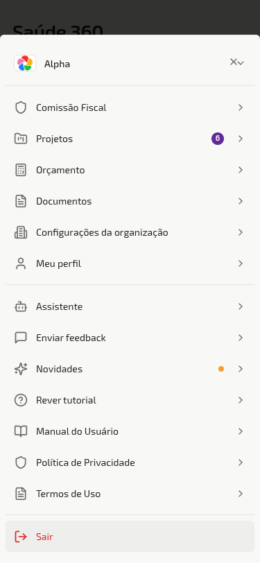
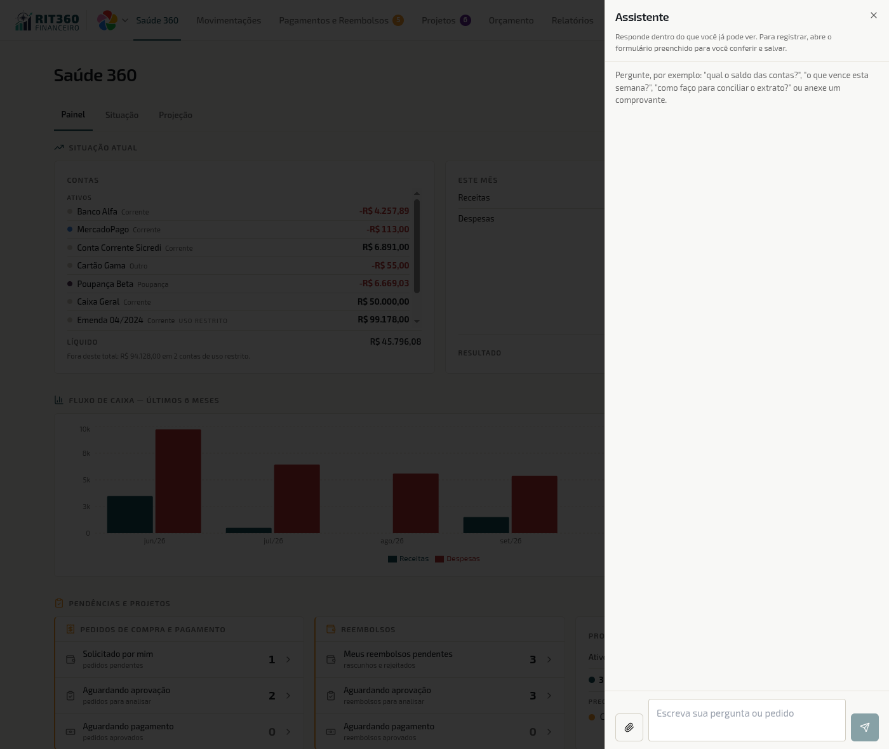
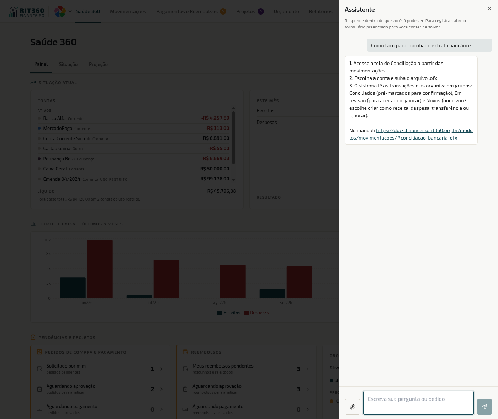
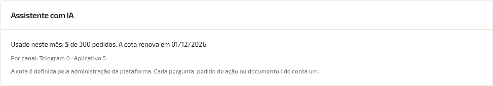

O **Assistente** é uma janela de conversa dentro do RIT360 Financeiro. Você escreve (ou anexa um comprovante) e ele faz três coisas: **responde perguntas sobre os números da sua OSC**, **explica como se faz uma tarefa no sistema** e **prepara o preenchimento de um lançamento, reembolso ou pedido** para você conferir e salvar.

> 💡 **Por que isso importa**
>
> Boa parte do tempo perdido num sistema financeiro não é digitar, é procurar: em qual tela está o saldo, onde se concilia o extrato, qual dos pedidos espera o seu voto. O Assistente encurta esse caminho — você pergunta do jeito que falaria com um colega e recebe a resposta, ou o formulário já com os campos que dava para preencher. E, como **nada é gravado até você salvar**, ele economiza digitação sem tirar de você a última palavra sobre o que entra na contabilidade da OSC.

## Onde fica o botão

No cabeçalho, ao lado de **Enviar feedback**, o ícone de robô com a dica **Abrir assistente**. No celular, ele está no menu **Mais**, com o nome **Assistente**.

*No computador: o ícone do Assistente fica ao lado de Enviar feedback*

*No celular: toque em Mais e depois em Assistente*

> ⚠️ **Atenção · Não achou o botão?**
>
> O Assistente só aparece nas organizações em que ele está **ligado**. Quem liga, desliga e define a cota de pedidos do mês é o **administrador da plataforma**, por organização. Uma organização começa com o assistente ligado e **300 pedidos por mês**. Se o botão não aparece para ninguém da sua OSC, peça a quem administra que consulte a equipe da RIT; não é uma questão de cargo ou permissão sua.

## O que você pode pedir

### Perguntar sobre os dados da OSC

Pergunte em linguagem comum. Exemplos que ele entende:

- *"Qual o saldo das contas?"*
- *"O que vence esta semana?"* e *"o que está atrasado?"*
- *"Como está o resumo do mês?"*
- *"Quais são os meus reembolsos e pedidos?"*
- *"O que está aguardando a minha aprovação?"*
- *"Qual a situação do projeto Campanha de Arrecadação?"*

*A janela do Assistente aberta: o texto de abertura já sugere o que perguntar*

> 📖 **Conceito · Ele só mostra o que você já veria nas telas**
>
> As respostas respeitam o seu cargo e as suas permissões, exatamente como as telas. O Assistente **não abre acesso novo**: quem não enxerga as contas de uso restrito ou os projetos de outra equipe também não os vê pelo chat. Se você perguntar por algo fora do seu alcance, ele **explica** que você não tem permissão, em vez de responder.

### Tirar dúvida de uso

Pergunte *"como faço…"* ou *"onde fica…"*. A resposta vem **do próprio manual**, com o link da página para você continuar a leitura.

*Pergunta "Como faço para conciliar o extrato bancário?": os passos vêm do manual, com o link no fim da resposta*

Se a resposta não estiver no manual, ele não inventa: responde **"Não encontrei isso no manual. Fale com o suporte pelo botão Enviar feedback."** Use o botão ao lado do Assistente — é o caminho que leva a dúvida à equipe, e é também o que faz o manual ganhar a página que faltava (ver [Enviar feedback](/enviar-feedback/)).

### Registrar um lançamento, reembolso ou pedido

Há dois jeitos de começar:

1. **Por frase.** Escreva, por exemplo, *"lança uma despesa de limpeza de 300 reais"*.
2. **Por documento.** Use o clipe para anexar a **foto ou o PDF do comprovante, nota ou boleto** (até **10 MB**).

Em qualquer dos dois, o Assistente mostra um **resumo do que entendeu** e o botão **Abrir formulário**. Ao clicar, abre o formulário de **lançamento**, de **reembolso** ou de **pedido**, já preenchido, com o aviso de que há **campos preenchidos pelo assistente** (quando vieram de um arquivo, o aviso é **Lido do documento**). Confira, complete o que faltar e salve **do jeito de sempre**.

> 📖 **Conceito · Nada é gravado até você salvar**
>
> Abrir o formulário não cria registro nenhum. Se você fechar a página sem salvar, não sobra nada. A gravação continua dependendo do seu clique em salvar, com todas as regras de sempre (permissão, aprovação, quórum).

> ⚠️ **Atenção · O que ele preenche e o que ele deixa em branco**
>
> - **Valor e data** só entram se estiverem **na sua mensagem ou no documento**. Se você não disse nem o comprovante mostra, o campo fica vazio, e o Assistente não chuta.
> - **Conta, categoria, centro de custo e projeto nunca são preenchidos por ele.** Essas escolhas definem onde o dinheiro aparece nos relatórios, e quem decide é você.
>
> Consequência prática: um lançamento salvo com a conta errada some do saldo certo e aparece no errado. Antes de salvar, olhe especialmente esses quatro campos.

> ⚠️ **Atenção · Dados de pagamento lidos de documento merecem dupla conferência**
>
> Se o documento trouxer PIX, conta bancária ou código de barras, compare cada dígito com o original. Um dígito lido errado paga a conta errada.

## O que ele não faz

O Assistente **não aprova, não paga e não estorna**. São decisões com dinheiro e responsabilidade, e ficam nas telas, com o seu nome. Se você pedir, ele responde **"Ainda não sei fazer isso por aqui"** e você faz pelo caminho normal.

## Quanto custa: a cota do mês

Cada **pedido** ao Assistente consome **uma unidade** da cota mensal da organização: uma pergunta, um pedido de ação ou um documento lido. A cota é da **organização**, não de cada pessoa: todo mundo consome do mesmo total.

- **Arquivo que já foi lido nas últimas 24 horas não conta de novo.** Anexar duas vezes o mesmo comprovante, no mesmo dia, gasta só uma unidade.
- **Aos 80% da cota** aparece um aviso.
- **Acabou a cota?** Ele avisa e diz **quando ela renova**. Até lá, o caminho é o das telas, sem o Assistente.

*Quem administra a organização acompanha o uso em Configurações → Organização*

O **administrador da organização** vê o uso do mês no bloco **Assistente com IA**, em [Configurações da organização](/configuracoes/organizacao/): quanto foi usado, quando a cota renova e a divisão **por canal** (Telegram e Aplicativo). Quem muda o tamanho da cota é o administrador da plataforma.

> 💡 **Dica · Gaste a cota onde ela rende**
>
> Pergunta que você responde olhando a própria tela (um saldo que já está na Saúde 360) gasta uma unidade como qualquer outra. Reserve o Assistente para o que poupa tempo de verdade: dúvida de "onde fica", registro a partir de comprovante, cruzar o que está esperando por você. E junte o que der numa só mensagem, em vez de três.

## A conversa e a memória dele

- **A conversa some ao fechar a aba.** Não há histórico para voltar depois.
- Durante o uso, ele lembra **apenas das últimas trocas, por até 15 minutos** sem mexer, só para entender perguntas de continuação como *"e o do mês passado?"*. Passou disso, recomece a explicação.
- **Trocar de organização começa uma conversa nova**, sem nada da anterior.

## Pelo Telegram

O mesmo Assistente funciona pelo **Telegram**, para quem **vinculou a conta**. Para vincular, siga o passo a passo de [Meu Perfil → Telegram](/configuracoes/perfil/#telegram-avisos-direto-no-seu-telegram). O que vale no aplicativo vale lá: mesmas permissões, mesma cota (a divisão por canal aparece no bloco de uso). O envio de boletos e faturas pelo bot está em [Pedidos → Envio rápido via Telegram](/modulos/pedidos-pagamento/#envio-rápido-de-faturas-e-boletos-via-bot-do-telegram).

## Privacidade

O texto que você escreve e o arquivo que você anexa são enviados a um **provedor de inteligência artificial** para entender o pedido. O **registro de uso** de cada pedido (quem pediu, quando, por qual canal, de que tipo e com que resultado) **não guarda o conteúdo** da conversa nem dos arquivos. O detalhe completo, com os provedores e os prazos, está na [Política de Privacidade](/privacidade/).

> ⚠️ **Atenção · Comprovante pode conter dados de outras pessoas**
>
> Nota fiscal com CPF do fornecedor, recibo com o nome de um beneficiário: tudo o que está no arquivo vai ao provedor. Envie apenas o que a sua organização autoriza.

## Quando dá errado

| O que acontece | O que significa | O que fazer |
|---|---|---|
| O botão **Assistente** não aparece | O assistente está desligado na organização | Peça a quem administra a OSC que fale com a equipe da RIT |
| Ele avisa que você não tem permissão para ver aquilo | O dado está fora do que o seu cargo enxerga nas telas | Peça a quem administra que revise o seu cargo em [Cargos e permissões](/configuracoes/cargos/) |
| **"Não encontrei isso no manual. Fale com o suporte pelo botão Enviar feedback."** | A dúvida não está documentada | Use o botão **Enviar feedback** |
| **"Ainda não sei fazer isso por aqui"** | Você pediu algo que ele não faz (aprovar, pagar, estornar) | Faça pela tela correspondente |
| Aviso de cota a 80%, ou cota esgotada | O uso da organização no mês chegou perto do limite, ou ao limite | Siga pelas telas; a resposta informa quando a cota renova. O administrador da organização vê o uso em Configurações → Organização |
| O arquivo não é aceito | Passa de **10 MB** ou não é foto/PDF | Reduza o arquivo, ou tire uma foto mais leve, e envie de novo |
| O formulário abriu com um campo vazio | Valor ou data não estavam na mensagem nem no documento | Preencha você mesmo, é o comportamento esperado |
| O formulário abriu com um valor que você acha errado | Leitura de foto ruim ou documento ambíguo | Corrija antes de salvar. Foto reta, com boa luz e sem dobras ajuda |

## Perguntas rápidas

**O Assistente pode apagar ou alterar um lançamento que já existe?**
Não. Ele abre formulários para criar. Mudanças em registros existentes são feitas pelas telas.

**Quem mais vê o que eu pergunto?**
A conversa some ao fechar a aba, e a organização não tem tela para ler o que você escreveu. O que fica é o registro de uso da cota, **sem o conteúdo**.

**Perguntei de manhã e à tarde a mesma coisa. Contou duas vezes?**
Sim, cada pergunta é um pedido. Só o **arquivo já lido nas últimas 24 horas** é poupado.

**Ele erra?**
Pode errar, principalmente ao ler fotos ruins. Por isso o formulário vem para a sua conferência e nada é salvo sem você.

**Posso usar para tirar dúvida de contabilidade?**
Ele responde dúvidas **de uso do sistema**, a partir deste manual. Para orientação contábil ou jurídica, o caminho continua sendo o profissional da OSC.

## Por onde seguir

- [Movimentações](/modulos/movimentacoes/): o formulário de lançamento que o Assistente preenche.
- [Reembolsos](/modulos/reembolsos/) e [Pedidos de Compra e Pagamento](/modulos/pedidos-pagamento/): os outros dois formulários, e o botão **Preencher a partir do arquivo**, que também lê comprovantes.
- [Meu Perfil → Telegram](/configuracoes/perfil/#telegram-avisos-direto-no-seu-telegram): vincular a conta para usar o Assistente por lá.
- [Política de Privacidade](/privacidade/): o que é enviado ao provedor de IA e por quanto tempo fica guardado.
