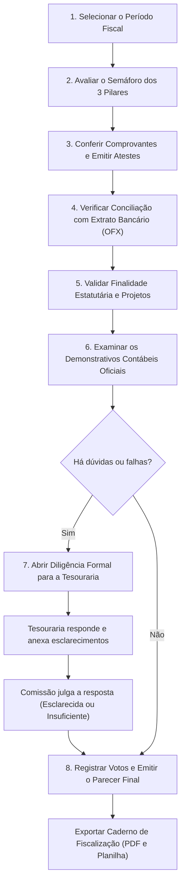

> Disponível para membros da **Comissão Fiscal** e em modo consulta para **Presidente** e **Diretor**.

O módulo **Comissão Fiscal** é o ambiente de trabalho onde os conselheiros fiscais da OSC examinam lançamentos, conferem comprovantes e extratos bancários, formulam diligências à tesouraria e emitem o parecer oficial conclusivo sobre a prestação de contas.

*Painel de Fiscalização — Cabeçalho com métricas, semáforo dos Três Pilares e abas de conferência*

> 💡 **Por que isso importa**
>
> A maioria dos conselheiros fiscais é formada por **voluntários que atuam intensamente apenas uma ou duas vezes ao ano**, às vésperas da Assembleia Geral Ordinária de prestação de contas. 
>
> No passado, esse trabalho exigia folhear pastas físicas com centenas de notas grampeadas a extratos em papel. No RIT360 Financeiro, todo o processo é digital: você analisa a conformidade das contas em qualquer computador, cruza movimentações com o extrato bancário em segundos, confere comprovantes com um clique e gera o **Caderno de Fiscalização** e o **Parecer Conclusivo** com validade jurídica e integridade criptográfica.

> 🔒 **Regra de ouro: A Comissão Fiscal vê tudo e não opera nada**
>
> A Comissão Fiscal tem acesso de leitura irrestrito a todos os dados financeiros, fiscais e contábeis da OSC. No entanto, para preservar a independência do órgão, **os conselheiros não operam o sistema**: não criam receitas nem despesas, não pagam contas, não realizam transferências e não aprovam reembolsos ou pedidos de compra. Se algo estiver incorreto, a comissão formula uma **Diligência** para que a Tesouraria ou Diretoria corrija.

---

## 1. O Roteiro de Fiscalização em 8 Passos

Se você abriu o sistema para realizar a fiscalização anual ou periódica, este é o fluxo ideal de trabalho:

---

## 2. Seleção e Situação dos Períodos de Fiscalização

Ao entrar no módulo pelo menu superior **Comissão Fiscal**, a primeira tela apresenta a relação de todos os exercícios fiscais da OSC:

*Lista de períodos de fiscalização da OSC e indicador de situação*

Cada período exibe seu intervalo de datas, a periodicidade estatutária e o selo de situação:

| Situação | O que significa | O que o conselheiro pode fazer |
|---|---|---|
| **Aberto para análise** | A tesouraria encerrou a escrituração do período e liberou as contas para a comissão fiscal. | Analisar lançamentos, abrir comprovantes, emitir atestes e registrar diligências. |
| **Em diligência** | A comissão enviou questionamentos formais e está aguardando o envio de esclarecimentos ou documentos adicionais pela tesouraria. | Acompanhar prazos e analisar as respostas que forem protocoladas. |
| **Em deliberação** | A instrução e as diligências foram encerradas. O período está aberto para votação dos conselheiros. | Registrar o voto individual (favorável, com ressalvas ou desfavorável) e justificar. |
| **Concluído** | A deliberação colegiada foi finalizada e o parecer oficial foi emitido/homologado. | Consultar o parecer assinado, o histórico de votos e baixar o Caderno de Fiscalização. |

> 💡 **Como abrir um novo período**
>
> Se a OSC estiver configurada para **abertura manual**, o Presidente da Comissão Fiscal ou o Administrador da OSC pode clicar no botão **"+ Novo período fiscal"**, informar o título do exercício (ex.: *"Exercício Fiscal 2026"*), selecionar as datas inicial e final e confirmar. O sistema criará o período e vinculará automaticamente os mandatos vigentes.

---

## 3. O Semáforo dos Três Pilares da Conformidade

Ao abrir um período em análise, o cabeçalho do painel apresenta o **Semáforo dos Três Pilares** — a régua visual que resume instantaneamente a saúde fiscal das contas:

*Cabeçalho do workspace: resumo financeiro e semáforo percentual dos 3 pilares*

O semáforo analisa 100% dos lançamentos do período sob três ângulos obrigatórios:

### Pilar 1: Comprovantes Fiscais
- **O que avalia**: O percentual de despesas que possuem comprovante hábil anexado (nota fiscal eletrônica, cupom fiscal, recibo formal de prestação de serviços, etc.).
- **Isenções automáticas**: O sistema dispensa automaticamente comprovantes para despesas da categoria de **Tarifas Bancárias** ou outras categorias que a OSC configurou como isentas de documento fiscal externo. Essas despesas são comprovadas pelo próprio extrato bancário oficial e não penalizam o índice do pilar.
- **Meta recomendada**: 100% das despesas não isentas comprovadas.

### Pilar 2: Extrato Bancário
- **O que avalia**: O percentual de lançamentos do sistema que foram perfeitamente conciliados contra as linhas do extrato eletrônico bancário (arquivos OFX importados).
- **Meta recomendada**: 100% de conciliação. Lançamentos sem correspondência bancária representam despesas não pagas, pagamentos duplicados ou omissão de receitas.

### Pilar 3: Finalidade Estatutária
- **O que avalia**: O percentual de recursos direcionados estritamente às atividades-fins da entidade ou a projetos aprovados no Plano de Trabalho da OSC.
- **Meta recomendada**: Conformidade com as diretrizes orçamentárias e limites estatutários para despesas de custeio/administração geral.

---

## 4. Conferência de Comprovantes e Ateste

Na aba **Comprovantes**, o conselheiro examina detalhadamente cada saída de caixa da OSC:

### Visualização Rápida de Anexos
- Cada linha da tabela exibe a data, descrição, fornecedor, valor, categoria contábil e o ícone de anexo.
- Clique no ícone de **arquivo / documento** ou no botão de visualização para abrir a nota fiscal, fatura ou recibo imediatamente na tela, sem precisar fazer download para o seu computador.

### Como Atestar um Lançamento
1. Após verificar a nota e constatar que o valor, a data e a descrição batem com o lançamento, localize a coluna de **Ateste**.
2. Clique no botão de confirmação (**Conforme**).
3. O lançamento receberá um selo verde e o nome do conselheiro que realizou a conferência.

### O Botão "Atestar Todas Conformes"
Para agilizar o trabalho em organizações com centenas de despesas rotineiras:
- Clique no botão **"Atestar todas conformes"** no topo da tabela.
- 💡 **Salvaguarda inteligente**: O sistema **NÃO atesta indiscriminadamente**. Ele atesta apenas os lançamentos que cumprem simultaneamente todos os requisitos de segurança (possuem anexo válido anexado, estão com conciliação bancária 100% confirmada e não possuem pendência de finalidade). Lançamentos com qualquer inconsistência continuam pendentes para exame manual.

> 🔒 **Regra Ética de Impedimento e Abstenção Automática**
>
> Se você, conselheiro fiscal, ocupou em algum momento anterior do ano o papel de coordenador de projeto ou voluntário e foi o **criador de um lançamento de reembolso ou despesa**, o sistema detecta o conflito de interesses.
>
> **O que o sistema faz:** O botão de ateste naquele lançamento específico fica desabilitado para você, registrando automaticamente sua **abstenção por impedimento ético**. Os demais membros do conselho realizarão a conferência desse item.

---

## 5. Conferência do Extrato Bancário (Conciliação OFX)

Clique na aba **Extrato bancário**:

*Conferência do extrato bancário oficial e conciliação de lançamentos*

Nesta aba, a Comissão Fiscal audita se o que está registrado no sistema corresponde fielmente ao que entrou e saiu das contas correntes e aplicações da OSC:

- **Saldos Inicial e Final**: O sistema exibe o saldo de abertura em 1º de janeiro (ou início do período) e o saldo de fechamento do período fiscal para cada conta bancária cadastrada.
- **Linhas do Extrato OFX**: Todas as transações bancárias oficiais importadas pela tesouraria aparecem listadas lado a lado com as movimentações contábeis.
- **Indicador de Divergência**: Se houver alguma linha do extrato bancário sem movimentação correspondente (ou com diferença de centavos), o item é destacado em vermelho.

> 💡 **O que fazer ao encontrar divergência bancária**
>
> Não tente consertar a movimentação (você não tem permissão para isso). Abra a aba **Diligências** e solicite à Tesouraria que realize a conciliação daquela linha bancária específica.

---

## 6. Finalidade Estatutária e Projetos

Clique na aba **Finalidade e projetos**:

*Classificação de despesas por projeto, rubrica e finalidade institucional*

A Comissão Fiscal deve garantir que os recursos captados pela OSC foram aplicados de acordo com o objeto social do Estatuto e com os termos de fomento ou convênios vigentes:

- **Distribuição por Projeto**: Visualize o montante alocado em cada projeto da OSC e quanto foi destinado ao custeio da sede administrativa.
- **Rubricas Orçamentárias**: Verifique se os gastos respeitaram as rubricas planejadas (ex.: recursos de edital carimbados para materiais didáticos não podem ser desvirtuados para reformas de sede).
- **Semáforo do Plano de Trabalho**: Aponta desvios orçamentários acima da margem permitida no plano de trabalho anual.

---

## 7. Demonstrativos Contábeis Oficiais

Clique na aba **Demonstrativos contábeis**:

*Peças contábeis oficiais: Balanço Patrimonial, DRE, Balancete e Notas Explicativas*

Além dos lançamentos operacionais, o Conselho Fiscal deve analisar as peças contábeis formais elaboradas pelo contador habilitado (com registro no CRC):

1. **Balanço Patrimonial**: Demonstra o ativo, passivo e patrimônio líquido da entidade.
2. **Demonstração do Resultado do Exercício (DRE)**: Demonstra o superávit ou déficit apurado no ano.
3. **Demonstração dos Fluxos de Caixa (DFC)**: Evidencia as entradas e saídas operacionais, de investimento e financiamento.
4. **Notas Explicativas**: Detalham critérios contábeis, contingências judiciais e doações com restrição.

A tesouraria faz o upload dos PDFs assinados com certificado digital. A comissão pode abrir os arquivos em tela cheia e checar se os números contábeis batem com os relatórios gerenciais do RIT360.

---

## 8. Formulação e Julgamento de Diligências

Clique na aba **Diligências**:

*Painel de diligências: abertura de questionamento, respostas da tesouraria e julgamento de mérito*

Se durante a análise a comissão identificar notas ilegíveis, despesas sem comprovante ou divergências bancárias, deve abrir uma **Diligência Formal**:

### Como Abrir uma Diligência
1. Clique no botão **"+ Nova diligência"**.
2. Selecione o lançamento ou assunto objeto do questionamento.
3. Redija a dúvida de forma objetiva (ex.: *"Nota Fiscal nº 1042 referente a serviço de transporte não apresenta detalhamento do itinerário nem relatório da viagem. Favor anexar a lista de beneficiários transportados."*).
4. O sistema notifica o Tesoureiro e o Presidente da OSC e inicia a contagem do **prazo de resposta** (em dias úteis).

### Resposta da Tesouraria e Julgamento do Mérito
- A tesouraria responde diretamente pelo sistema e pode anexar novos arquivos e justificativas.
- Ao receber a resposta, o conselheiro fiscal avalia o esclarecimento e clica em:
  - **Esclarecida (Saneada)**: A resposta sanou a dúvida e o documento complementar foi validado. O lançamento torna-se apto para ateste.
  - **Insuficiente (Não saneada)**: A resposta não justificou a irregularidade. O apontamento é **automaticamente convertido em Ressalva** para constar no parecer final.

---

## 9. Deliberação Colegiada, Voto e Emissão do Parecer

Com a instrução concluída, acesse a aba **Deliberação e parecer**:

*Deliberação colegiada: registro de votos, cálculo de quórum e emissão de parecer*

### Registro do Voto Individual
Cada membro titular habilitado registra seu voto no painel:

- **Favorável sem ressalvas**: Contas regulares, comprovadas e conciliadas em sua totalidade.
- **Favorável com ressalvas**: Contas substancialmente regulares, mas com pequenas falhas formais que não causaram prejuízo ao patrimônio da OSC (as ressalvas abertas no módulo de diligências são listadas automaticamente).
- **Desfavorável (Rejeição)**: Identificação de irregularidades graves, desvio de finalidade, pagamentos sem comprovação ou recusa injustificada em responder diligências.

O conselheiro deve digitar a sua **Fundamentação do Voto** no campo de texto e clicar em **"Registrar Voto"**.

### Cômputo do Quórum
O sistema calcula em tempo real o quórum estatutário (Maioria Simples, Maioria Absoluta ou Unanimidade, conforme a configuração da OSC). Conselheiros com impedimento ético não contam no denominador do quórum de maioria.

> ⚠️ **Silêncio Institucional e Ausência de Aprovação Tácita**
>
> Se o prazo final de deliberação vencer e algum conselheiro titular não tiver registrado seu voto, **o sistema não presume aprovação**. A situação passa a constar como *Pendente por decurso de prazo*, exigindo que o Presidente da Comissão convoque o suplente correspondente ou certifique a ocorrência na ata.

### Emissão do Parecer Final
Aprovada a deliberação, há duas modalidades de formalização do documento:

1. **Emissão Direta pelo RIT360 (Recomendado)**:
   - O sistema compila o cabeçalho oficial da OSC, os dados do exercício, o extrato do semáforo dos 3 pilares, a lista de diligências saneadas, as ressalvas remanescentes, os votos nominais de cada conselheiro e a conclusão final.
   - O parecer é gerado em formato PDF assinado eletronicamente com carimbo de data/hora e **código verificador de integridade SHA-256**, permitindo que qualquer pessoa confirme a autenticidade do documento escaneando o QR Code ou digitando o hash no site oficial.
2. **Anexo de Parecer Físico / Externo**:
   - Se o estatuto da sua entidade exigir que a comissão assine fisicamente uma via em papel durante a reunião presencial prévia à Assembleia, você pode gerar a ata em cartório, colher as assinaturas de punho e fazer o **upload do PDF digitalizado** na própria tela para arquivamento definitivo.

### Exportação do Caderno de Fiscalização
No canto superior direito, clique em **"Caderno de Fiscalização"**:
- **Versão em PDF**: Dossiê completo encadernado contendo o parecer, balancetes, histórico de diligências e todas as notas fiscais atestadas em anexo. Ideal para instruir o processo de prestação de contas na Assembleia Geral ou entregar a auditores externos.
- **Versão em Planilha (XLSX)**: Planilha auditável com todos os lançamentos, dados de ateste, data de conferência e status de conciliação bancária para auditorias detalhadas.

---

## Dicas Prontas e Armadilhas Reais

> 💡 **Dica de ouro: Comece pelas maiores despesas (Curva ABC)**
>
> Se a sua OSC teve mais de 500 lançamentos no ano, ordene a tabela de comprovantes pelo valor decrescente. Ao atestar as despesas que representam os maiores volumes financeiros (geralmente 20% das notas respondem por 80% do dinheiro), você audita rapidamente a maior parte do patrimônio da organização.

> ⚠️ **Armadilha · Confundir comprovante de pagamento bancário com comprovante fiscal**
>
> **O erro:** Atestar uma despesa anexando apenas o comprovante de PIX ou o comprovante de débito da conta bancária.
>
> **A consequência:** Comprovante bancário prova apenas que o dinheiro saiu da conta da OSC; ele **não comprova o que foi comprado nem a idoneidade da operação**. Órgãos como o Ministério Público, Receita Federal e financiadores públicos (MROSC) exigem a **Nota Fiscal Eletrônica** ou Cupom Fiscal nominal ao CNPJ da OSC. Lançamentos com apenas comprovante bancário devem receber Diligência para localização da nota fiscal.

> ⚠️ **Armadilha · Conselheiro fiscal aprovar o próprio reembolso**
>
> **O erro:** Um conselheiro fiscal que também atua em campo participa do ateste de uma viagem em que ele próprio foi ressarcido.
>
> **A consequência:** O ateste é juridicamente nulo por vício de parcialidade. Sempre confira se o sistema aplicou a abstenção automática por impedimento. Se porventura você estiver registrado sob outro usuário, decline formalmente do ateste nas notas relativas a você.

---

## Perguntas Frequentes (FAQ)

### 1. Sou suplente do Conselho Fiscal. Posso votar?
O suplente tem acesso de leitura para acompanhar todas as etapas da fiscalização. No entanto, o botão de voto só é liberado para o suplente caso o Presidente da Comissão convoque a substituição formal de um titular ausente ou impedido.

### 2. O que acontece se uma diligência não for respondida no prazo?
Ao expirar o prazo em dias úteis, o sistema encerra a fase de instrução e transporta o questionamento sem resposta diretamente para o relatório de deliberação. Os conselheiros devem levar a falta de resposta em consideração ao votar (geralmente gerando aprovação com ressalvas ou rejeição das contas).

### 3. O Conselho Fiscal pode reprovar uma despesa individualmente?
O conselheiro não "apaga" nem "estorna" o lançamento. Ele recusa o ateste e abre diligência. Na deliberação final, o colegiado pode opinar pela aprovação das contas gerais com ressalva referente àquele valor específico, recomendando que a Diretoria cobre a restituição do valor ao caixa da OSC.

### 4. Como os associados da OSC têm acesso ao parecer?
Após a conclusão do período, o parecer fica disponível em [Documentos](/modulos/documentos/) e pode ser impresso ou projetado durante a Assembleia Geral de prestação de contas. Se a OSC tiver ativado a [Página Pública de Transparência](/configuracoes/pagina-publica/), o parecer oficial homologado também pode ser disponibilizado para download aberto.

---

## Glossário dos Termos da Fiscalização

- **Ateste Fiscal**: Declaração formal e eletrônica emitida por conselheiro fiscal atestando que a nota fiscal ou documento de despesa é autêntico, regular e compatível com as atividades da entidade.
- **Conciliação OFX**: Cruzamento digital entre os registros contábeis do sistema e o arquivo padronizado de extrato bancário (OFX) fornecido pelas instituições financeiras.
- **Caderno de Fiscalização**: Livro eletrônico consolidado que reúne toda a documentação comprobatória, extratos, demonstrativos, diligências e pareceres do exercício.
- **Diligência**: Expediente oficial de fiscalização destinado a requerer esclarecimentos ou complementação de documentos antes do encerramento da instrução.
- **Hash SHA-256**: Código alfanumérico único gerado matematicamente a partir do conteúdo do parecer. Se uma única vírgula for alterada no documento após a emissão, o hash muda completamente, garantindo inviolabilidade perante terceiros.
- **Impedimento Ético**: Situação em que o conselheiro fiscal fica temporariamente impedido de manifestar-se ou votar em atos ou despesas das quais tenha participado como executor, solicitante ou beneficiário.
- **Parecer Favorável com Ressalva**: Juízo do conselho que aprova as contas no seu conjunto, mas aponta impropriedades pontuais de natureza formal que devem ser corrigidas pela diretoria nos exercícios futuros.
