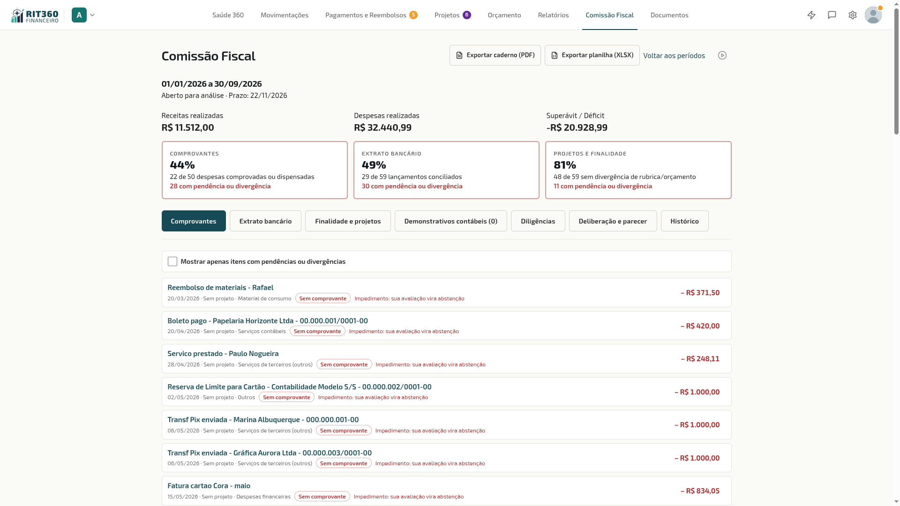
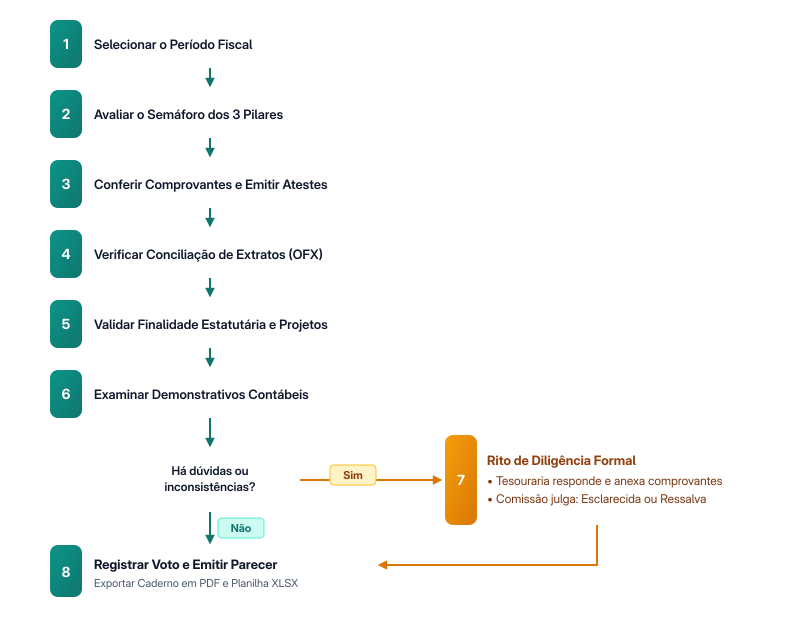
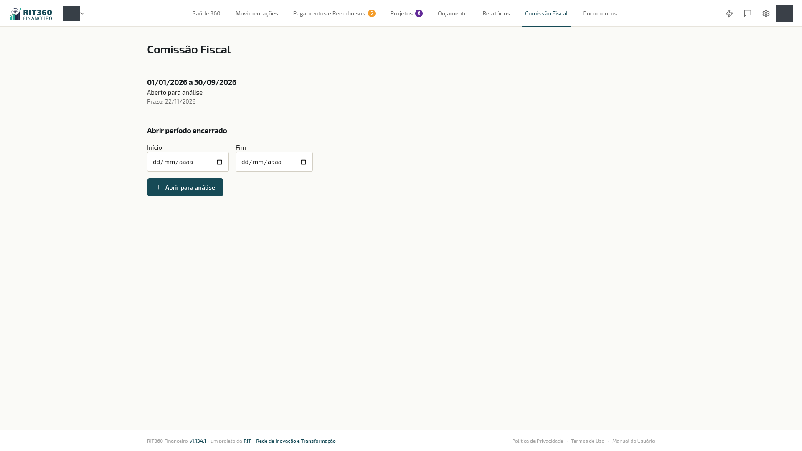
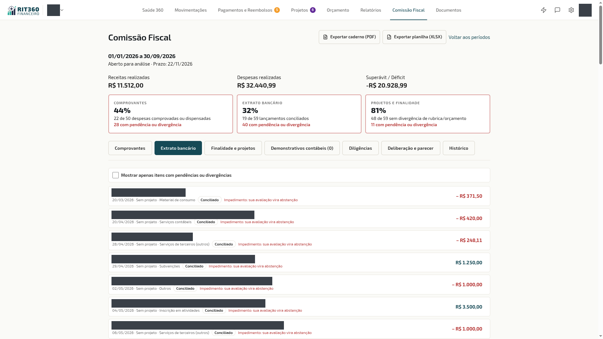
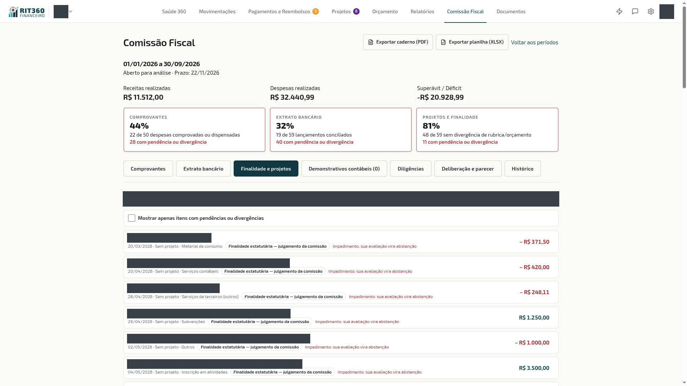
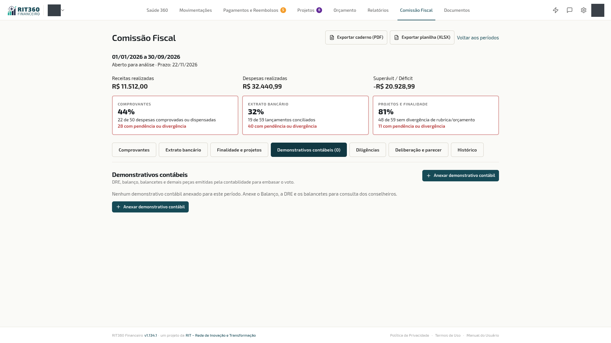
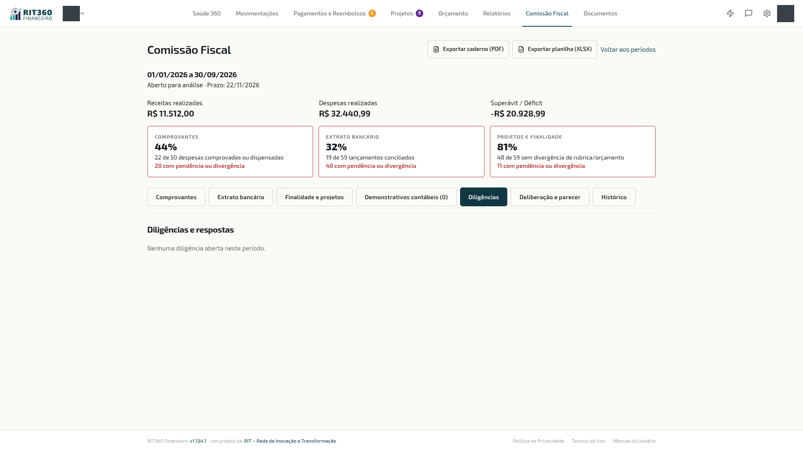
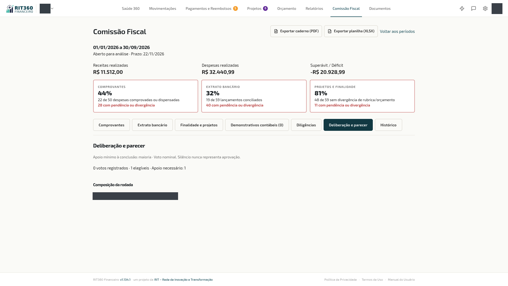

> Disponível para membros da **Comissão Fiscal** e em modo consulta para **Presidente** e **Diretor**.

O módulo **Comissão Fiscal** é o ambiente de trabalho onde os conselheiros fiscais da OSC examinam lançamentos, conferem comprovantes e extratos bancários, formulam diligências à tesouraria e emitem o parecer oficial conclusivo sobre a prestação de contas.

*Painel de Fiscalização — Cabeçalho com métricas, semáforo dos Três Pilares e abas de conferência*

> 💡 **Por que isso importa**
>
> A maioria dos conselheiros fiscais é formada por **voluntários que atuam intensamente apenas uma ou duas vezes ao ano**, às vésperas da Assembleia Geral Ordinária de prestação de contas. 
>
> No passado, esse trabalho exigia folhear pastas físicas com centenas de notas grampeadas a extratos em papel. No RIT360 Financeiro, todo o processo é digital: você analisa a conformidade das contas em qualquer computador, cruza movimentações com o extrato bancário em segundos, confere comprovantes com um clique e gera o **Caderno de Fiscalização** e o **Parecer Conclusivo** com validade jurídica e integridade criptográfica.

> 🔒 **Regra de ouro: A Comissão Fiscal vê tudo e não opera nada**
>
> A Comissão Fiscal tem acesso de leitura irrestrito a todos os dados financeiros, fiscais e contábeis da OSC. No entanto, para preservar a independência do órgão, **os conselheiros não operam o sistema**: não criam receitas nem despesas, não pagam contas, não realizam transferências e não aprovam reembolsos ou pedidos de compra. Se algo estiver incorreto, a comissão formula uma **Diligência** para que a Tesouraria ou Diretoria corrija.

---

## 1. O Roteiro de Fiscalização em 8 Passos

Se você abriu o sistema para realizar a fiscalização anual ou periódica, este é o fluxo ideal de trabalho:

*O rito estatutário da Comissão Fiscal em 8 passos: da conferência dos 3 pilares à emissão do parecer oficial.*

---

## 2. Seleção e Situação dos Períodos de Fiscalização

Ao entrar no módulo pelo menu superior **Comissão Fiscal**, a primeira tela apresenta a relação de todos os exercícios fiscais da OSC:

*Lista de períodos de fiscalização da OSC e indicador de situação*

Cada período exibe seu intervalo de datas, a periodicidade estatutária e o selo de situação:

| Situação | O que significa | O que o conselheiro pode fazer |
|---|---|---|
| **Aberto para análise** | A tesouraria encerrou a escrituração do período e liberou as contas para a comissão fiscal. | Analisar lançamentos, abrir comprovantes, emitir atestes e registrar diligências. |
| **Em diligência** | A comissão enviou questionamentos formais e está aguardando o envio de esclarecimentos ou documentos adicionais pela tesouraria. | Acompanhar prazos e analisar as respostas que forem protocoladas. |
| **Em deliberação** | A instrução e as diligências foram encerradas. O período está aberto para votação dos conselheiros. | Registrar o voto individual (favorável, com ressalvas ou desfavorável) e justificar. |
| **Concluído** | A deliberação colegiada foi finalizada e o parecer oficial foi emitido/homologado. | Consultar o parecer assinado, o histórico de votos e baixar o Caderno de Fiscalização. |

> 💡 **Como abrir um novo período**
>
> Se a OSC estiver configurada para **abertura manual**, o Presidente da Comissão Fiscal ou o Administrador da OSC pode clicar no botão **"+ Novo período fiscal"**, informar o título do exercício (ex.: *"Exercício Fiscal 2026"*), selecionar as datas inicial e final e confirmar. O sistema criará o período e vinculará automaticamente os mandatos vigentes.

---

## 3. O Semáforo dos Três Pilares da Conformidade

Ao abrir um período em análise, o cabeçalho do painel apresenta o **Semáforo dos Três Pilares** — a régua visual que resume instantaneamente a saúde fiscal das contas:

*Cabeçalho do workspace: resumo financeiro e semáforo percentual dos 3 pilares*

O semáforo analisa 100% dos lançamentos do período sob três ângulos obrigatórios:

### Pilar 1: Comprovantes Fiscais
- **O que avalia**: O percentual de despesas que possuem comprovante hábil anexado (nota fiscal eletrônica, cupom fiscal, recibo formal de prestação de serviços, etc.).
- **Isenções automáticas**: O sistema dispensa automaticamente comprovantes para despesas da categoria de **Tarifas Bancárias** ou outras categorias que a OSC configurou como isentas de documento fiscal externo. Essas despesas são comprovadas pelo próprio extrato bancário oficial e não penalizam o índice do pilar.
- **Meta recomendada**: 100% das despesas não isentas comprovadas.

### Pilar 2: Extrato Bancário
- **O que avalia**: O percentual de lançamentos do sistema que foram perfeitamente conciliados contra as linhas do extrato eletrônico bancário (arquivos OFX importados).
- **Meta recomendada**: 100% de conciliação. Lançamentos sem correspondência bancária representam despesas não pagas, pagamentos duplicados ou omissão de receitas.

### Pilar 3: Finalidade Estatutária
- **O que avalia**: O percentual de recursos direcionados estritamente às atividades-fins da entidade ou a projetos aprovados no Plano de Trabalho da OSC.
- **Meta recomendada**: Conformidade com as diretrizes orçamentárias e limites estatutários para despesas de custeio/administração geral.

---

## 4. Conferência de Comprovantes e Ateste

Na aba **Comprovantes**, o conselheiro examina detalhadamente cada saída de caixa da OSC:

### Visualização Rápida de Anexos
- Cada linha da tabela exibe a data, descrição, fornecedor, valor, categoria contábil e o ícone de anexo.
- Clique no ícone de **arquivo / documento** ou no botão de visualização para abrir a nota fiscal, fatura ou recibo imediatamente na tela, sem precisar fazer download para o seu computador.

### Como Atestar um Lançamento
1. Após verificar a nota e constatar que o valor, a data e a descrição batem com o lançamento, localize a coluna de **Ateste**.
2. Clique no botão de confirmação (**Conforme**).
3. O lançamento receberá um selo verde e o nome do conselheiro que realizou a conferência.

### O Botão "Atestar Todas Conformes"
Para agilizar o trabalho em organizações com centenas de despesas rotineiras:
- Clique no botão **"Atestar todas conformes"** no topo da tabela.
- 💡 **Salvaguarda inteligente**: O sistema **NÃO atesta indiscriminadamente**. Ele atesta apenas os lançamentos que cumprem simultaneamente todos os requisitos de segurança (possuem anexo válido anexado, estão com conciliação bancária 100% confirmada e não possuem pendência de finalidade). Lançamentos com qualquer inconsistência continuam pendentes para exame manual.

> 🔒 **Regra Ética de Impedimento e Abstenção Automática**
>
> Se você, conselheiro fiscal, ocupou em algum momento anterior do ano o papel de coordenador de projeto ou voluntário e foi o **criador de um lançamento de reembolso ou despesa**, o sistema detecta o conflito de interesses.
>
> **O que o sistema faz:** O botão de ateste naquele lançamento específico fica desabilitado para você, registrando automaticamente sua **abstenção por impedimento ético**. Os demais membros do conselho realizarão a conferência desse item.

---

## 5. Conferência do Extrato Bancário (Conciliação OFX)

Clique na aba **Extrato bancário**:

*Conferência do extrato bancário oficial e conciliação de lançamentos*

Nesta aba, a Comissão Fiscal audita se o que está registrado no sistema corresponde fielmente ao que entrou e saiu das contas correntes e aplicações da OSC:

- **Saldos Inicial e Final**: O sistema exibe o saldo de abertura em 1º de janeiro (ou início do período) e o saldo de fechamento do período fiscal para cada conta bancária cadastrada.
- **Linhas do Extrato OFX**: Todas as transações bancárias oficiais importadas pela tesouraria aparecem listadas lado a lado com as movimentações contábeis.
- **Indicador de Divergência**: Se houver alguma linha do extrato bancário sem movimentação correspondente (ou com diferença de centavos), o item é destacado em vermelho.

> 💡 **O que fazer ao encontrar divergência bancária**
>
> Não tente consertar a movimentação (você não tem permissão para isso). Abra a aba **Diligências** e solicite à Tesouraria que realize a conciliação daquela linha bancária específica.

---

## 6. Finalidade Estatutária e Projetos

Clique na aba **Finalidade e projetos**:

*Classificação de despesas por projeto, rubrica e finalidade institucional*

A Comissão Fiscal deve garantir que os recursos captados pela OSC foram aplicados de acordo com o objeto social do Estatuto e com os termos de fomento ou convênios vigentes:

- **Distribuição por Projeto**: Visualize o montante alocado em cada projeto da OSC e quanto foi destinado ao custeio da sede administrativa.
- **Rubricas Orçamentárias**: Verifique se os gastos respeitaram as rubricas planejadas (ex.: recursos de edital carimbados para materiais didáticos não podem ser desvirtuados para reformas de sede).
- **Semáforo do Plano de Trabalho**: Aponta desvios orçamentários acima da margem permitida no plano de trabalho anual.

---

## 7. Demonstrativos Contábeis Oficiais

Clique na aba **Demonstrativos contábeis**:

*Peças contábeis oficiais: Balanço Patrimonial, DRE, Balancete e Notas Explicativas*

Além dos lançamentos operacionais, o Conselho Fiscal deve analisar as peças contábeis formais elaboradas pelo contador habilitado (com registro no CRC):

1. **Balanço Patrimonial**: Demonstra o ativo, passivo e patrimônio líquido da entidade.
2. **Demonstração do Resultado do Exercício (DRE)**: Demonstra o superávit ou déficit apurado no ano.
3. **Demonstração dos Fluxos de Caixa (DFC)**: Evidencia as entradas e saídas operacionais, de investimento e financiamento.
4. **Notas Explicativas**: Detalham critérios contábeis, contingências judiciais e doações com restrição.

A tesouraria faz o upload dos PDFs assinados com certificado digital. A comissão pode abrir os arquivos em tela cheia e checar se os números contábeis batem com os relatórios gerenciais do RIT360.

### Comparação com o app {#comparacao-com-o-app}

Ao anexar um demonstrativo, o RIT360 Financeiro lê o arquivo automaticamente e compara os números dele com os lançamentos do app. Abaixo do documento aparece **Comparação com o app**, com um resultado geral:

- **Convergente**: as linhas comparadas batem, centavo a centavo.
- **Divergente**: pelo menos uma linha não bate. A tela mostra o valor do documento, o valor do app e a diferença.
- **Não comparado**: nenhuma linha pôde ser comparada. A tela diz o motivo, por exemplo *"o documento ainda não foi lido"*.

> 💡 **Por que isso importa**
>
> O balanço e o balancete são o retrato que a contabilidade faz da OSC. Se o caixa dela não bate com o que o app mostra no mesmo dia, a diferença aparece agora, na conferência da comissão, e não depois, numa auditoria externa. A comparação não decide qual dos dois está certo, mas mostra onde olhar.

#### O que é comparado {#comparacao-o-que-e-comparado}

- **Caixa e equivalentes de caixa na data-base:** o total de caixa, bancos e aplicações de liquidez imediata na data do documento, comparado ao saldo das contas do app nessa mesma data. Contas de **cartão de crédito** ficam de fora da soma, porque a contabilidade as lança como dívida. A tela mostra quais contas foram somadas e quais ficaram de fora.
- **Entradas e saídas de caixa:** só são comparadas se o documento traz a **Demonstração dos Fluxos de Caixa** (ou um demonstrativo de movimentação de caixa). Sem fluxo de caixa, as duas linhas ficam como **Não comparado**, com o motivo *"o documento não traz fluxo de caixa"*.

#### Por que a DRE não entra na comparação {#comparacao-por-que-nao-dre}

> 📖 **Conceito · Competência não é caixa**
>
> A DRE registra receita e despesa no mês em que o fato acontece (regime de **competência**). O app registra quando o dinheiro efetivamente entra ou sai (regime de **caixa**). Exemplo: em outubro a OSC presta um serviço e emite uma nota de R$ 5.000,00. A DRE de outubro mostra R$ 5.000,00 de receita. O cliente só paga em dezembro, e o app só registra a entrada em dezembro. Os dois estão certos. Por isso a comparação usa só o caixa, que é a mesma base dos dois lados, e valores da DRE, como o resultado ou o superávit, não são usados como se fossem caixa.

#### Como ler cada linha {#comparacao-como-ler}

- **Documento**, **App** e **Diferença** aparecem lado a lado. A diferença só aparece quando a linha é Divergente.
- **Origem no documento** indica a página e o rótulo de onde o número foi lido, por exemplo *página 3 · "Caixa e equivalentes de caixa"*. Quando o documento está em milhares de reais, a tela avisa que o valor foi convertido para reais.
- Valores com **D** ou **C** no fim, como *3.927,30D*, são lidos. Nas contas de caixa, D é saldo positivo e C é saldo negativo. Nas entradas e saídas, vale só o valor absoluto. Um valor com D ou C junto de sinal ou de parênteses é ambíguo: não é interpretado, a linha fica **Não comparado** e a tela mostra o texto que foi lido.

> 💡 **Dica · Diferença pequena costuma ser conta que existe só de um lado**
>
> Quando a diferença é pequena, a causa mais comum é uma conta que existe de um lado só, como uma carteira de pagamento online cadastrada no app e ainda não contabilizada pela contabilidade. Antes de concluir que há erro, abra **Contas lado a lado**. Ela mostra as contas de cada lado, sem comparar uma a uma, e a conta que aparece de um lado e não do outro costuma explicar a diferença.

#### Ler de novo e corrigir valor lido {#comparacao-ler-de-novo-e-corrigir}

- **Ler de novo** refaz a leitura automática do arquivo. Use quando a leitura falhou. O botão aparece para quem pode anexar demonstrativos (a gestão) e para quem integra a comissão.
- **Corrigir valor lido** muda o número usado na comparação quando a leitura pegou o valor errado. O arquivo não muda. Digite o valor como está no documento, no formato brasileiro, por exemplo `1.234,56`. A data-base e as datas do intervalo têm correção própria, pelo botão **Corrigir**.

> ⚠️ **Armadilha · Corrigir até a linha ficar convergente**
>
> **O erro:** ajustar o valor lido até a comparação bater, sem conferir o número impresso no documento.
>
> **A consequência:** a tela passa a mostrar Convergente, mas a conferência deixa de dizer o que o demonstrativo diz. A correção fica registrada com o seu nome e a data, e o valor original continua guardado, então quem olhar depois vê quem mudou o quê. Corrija só quando a leitura errou, e confira a correção contra o PDF.

> ⚠️ **Armadilha · Anexar planilha em vez de PDF**
>
> **O erro:** anexar o balancete em planilha (XLSX), achando que a comparação será feita.
>
> **A consequência:** a planilha é aceita como anexo, mas a leitura automática não lê planilhas. A linha fica **Não comparado**, com o motivo *"formato não legível pela leitura automática (envie em PDF)"*. Peça à contabilidade o PDF do demonstrativo, ou exporte a planilha em PDF. Imagens em JPG e PNG são lidas.

> ⚠️ **Atenção · A leitura usa a cota do assistente**
>
> Cada leitura consome uma unidade da cota mensal de pedidos do [Assistente](/modulos/assistente/), que é da organização, não de cada pessoa. Há também um limite de leituras por hora. Quando a cota acaba, a leitura para com o motivo *"a cota mensal do assistente acabou"*, e a comparação fica como **Não comparado** até uma nova leitura ser feita com cota disponível. Releia só quando houver motivo: uma leitura que deu certo não precisa ser refeita.

---

## 8. Formulação e Julgamento de Diligências

Clique na aba **Diligências**:

*Painel de diligências: abertura de questionamento, respostas da tesouraria e julgamento de mérito*

Se durante a análise a comissão identificar notas ilegíveis, despesas sem comprovante ou divergências bancárias, deve abrir uma **Diligência Formal**:

### Como Abrir uma Diligência
1. Clique no botão **"+ Nova diligência"**.
2. Selecione o lançamento ou assunto objeto do questionamento.
3. Redija a dúvida de forma objetiva (ex.: *"Nota Fiscal nº 1042 referente a serviço de transporte não apresenta detalhamento do itinerário nem relatório da viagem. Favor anexar a lista de beneficiários transportados."*).
4. O sistema notifica o Tesoureiro e o Presidente da OSC e inicia a contagem do **prazo de resposta** (em dias úteis).

### Resposta da Tesouraria e Julgamento do Mérito
- A tesouraria responde diretamente pelo sistema e pode anexar novos arquivos e justificativas.
- Ao receber a resposta, o conselheiro fiscal avalia o esclarecimento e clica em:
  - **Esclarecida (Saneada)**: A resposta sanou a dúvida e o documento complementar foi validado. O lançamento torna-se apto para ateste.
  - **Insuficiente (Não saneada)**: A resposta não justificou a irregularidade. O apontamento é **automaticamente convertido em Ressalva** para constar no parecer final.

---

## 9. Deliberação Colegiada, Voto e Emissão do Parecer

Com a instrução concluída, acesse a aba **Deliberação e parecer**:

*Deliberação colegiada: registro de votos, cálculo de quórum e emissão de parecer*

### Registro do Voto Individual
Cada membro titular habilitado registra seu voto no painel:

- **Favorável sem ressalvas**: Contas regulares, comprovadas e conciliadas em sua totalidade.
- **Favorável com ressalvas**: Contas substancialmente regulares, mas com pequenas falhas formais que não causaram prejuízo ao patrimônio da OSC (as ressalvas abertas no módulo de diligências são listadas automaticamente).
- **Desfavorável (Rejeição)**: Identificação de irregularidades graves, desvio de finalidade, pagamentos sem comprovação ou recusa injustificada em responder diligências.

O conselheiro deve digitar a sua **Fundamentação do Voto** no campo de texto e clicar em **"Registrar Voto"**.

### Cômputo do Quórum
O sistema calcula em tempo real o quórum estatutário (Maioria Simples, Maioria Absoluta ou Unanimidade, conforme a configuração da OSC). Conselheiros com impedimento ético não contam no denominador do quórum de maioria.

> ⚠️ **Silêncio Institucional e Ausência de Aprovação Tácita**
>
> Se o prazo final de deliberação vencer e algum conselheiro titular não tiver registrado seu voto, **o sistema não presume aprovação**. A situação passa a constar como *Pendente por decurso de prazo*, exigindo que o Presidente da Comissão convoque o suplente correspondente ou certifique a ocorrência na ata.

### Emissão do Parecer Final
Aprovada a deliberação, há duas modalidades de formalização do documento:

1. **Emissão Direta pelo RIT360 (Recomendado)**:
   - O sistema compila o cabeçalho oficial da OSC, os dados do exercício, o extrato do semáforo dos 3 pilares, a lista de diligências saneadas, as ressalvas remanescentes, os votos (com o nome de cada conselheiro na modalidade Nominal; só o placar na Anônima) e a conclusão final.
   - O parecer é gerado em formato PDF assinado eletronicamente com carimbo de data/hora e **código verificador de integridade SHA-256**, permitindo que qualquer pessoa confirme a autenticidade do documento escaneando o QR Code ou digitando o hash no site oficial.
2. **Anexo de Parecer Físico / Externo** (aba **Anexar parecer externo**):
   - Use quando a comissão deliberou em reunião e assinou a ata ou o parecer **fora do sistema** — por exemplo, uma via em papel assinada na reunião prévia à Assembleia. Digitalize e anexe o **PDF** (até **20 MB**), escolhendo o **desfecho das contas**, e clique em **Anexar parecer e concluir o período**.
   - **O parecer externo só pode ser anexado depois da deliberação da comissão.** Enquanto os votos necessários não forem registrados, o botão fica indisponível, com a explicação *"O parecer externo também depende da deliberação da comissão: N de N votos necessários registrados… Anexe o arquivo depois que a votação terminar."* O motivo: um documento externo não pode substituir a votação; ele só formaliza o que a comissão já decidiu.
   - No envio, o sistema calcula a **impressão digital do arquivo (SHA-256)** e a guarda. Depois, ao conferir o parecer, ele confere se o arquivo guardado **não mudou desde o envio**. O PDF fica guardado de forma protegida e **não pode ser substituído depois**. Por isso, confira o arquivo antes de anexar: errar o arquivo não tem como corrigir pela mesma tela.
   - No histórico do período, o parecer aparece marcado como **"Emitido fora do sistema"**, com o botão **Baixar parecer externo preservado** e o código SHA-256.

> 💡 **Voto anônimo e parecer**
>
> Quando a modalidade do voto é **Anônimo**, a tela de deliberação avisa: *"Os demais membros não veem como você votou. O sistema guarda a ligação entre você e o seu voto, em registro separado, sem ligação visível na tela. Com poucos membros ou com unanimidade, dá para deduzir o voto."* Nessa modalidade, os votos aparecem sem nome e só o placar é exibido após a emissão. Veja a escolha da modalidade em [Configurações → Comissão Fiscal](/configuracoes/comissao-fiscal/).

### Exportação do Caderno de Fiscalização
No canto superior direito, clique em **"Caderno de Fiscalização"**:
- **Versão em PDF**: Dossiê completo encadernado contendo o parecer, balancetes, histórico de diligências e todas as notas fiscais atestadas em anexo. Ideal para instruir o processo de prestação de contas na Assembleia Geral ou entregar a auditores externos.
- **Versão em Planilha (XLSX)**: Planilha auditável com todos os lançamentos, dados de ateste, data de conferência e status de conciliação bancária para auditorias detalhadas.

---

## 10. Observações da gestão para a comissão {#observacoes-da-gestao}

Logo no topo do espaço de trabalho, acima da Pré-análise e das abas, fica o bloco **Observações da gestão para a comissão**. É onde quem administra as finanças explica o contexto do período antes de a comissão começar a ler.

<!-- CAPTURA PENDENTE: bloco "Observações da gestão" no topo do espaço de trabalho, com uma versão atual e o botão "Escrever nova versão". -->

> 💡 **Por que isso importa**
>
> Um conselheiro que abre o período sem saber que a conta bancária foi trocada no meio do ano, que uma compra foi parcelada por acordo com o fornecedor ou que um projeto terminou em setembro gasta horas tentando explicar uma diferença que a gestão já conhecia. Uma observação escrita antes da leitura vira contexto, e não suspeita. E como cada publicação fica registrada com autor e data, a explicação tem o mesmo peso de um documento.

### Quem escreve e quando {#observacoes-quem-e-quando}

- **Quem escreve:** quem tem permissão para administrar o período fiscal ou para responder diligências, em geral o tesoureiro e o presidente.
- **Quem não escreve:** quem tem o papel de Comissão Fiscal. O conselheiro lê o bloco e abre diligência quando precisa, mas não escreve observações da gestão, mesmo que tenha outro papel na OSC.
- **Quando:** enquanto o período está **em análise** ou **em revisão**.
- **A trava na votação:** quando o período entra em **deliberação**, o botão de escrever some e o bloco fica só para leitura. As versões já publicadas continuam visíveis.

> ⚠️ **Atenção · Depois que a votação começa, não há como explicar**
>
> **O erro:** deixar para escrever as observações quando a comissão já está votando.
>
> **A consequência:** a votação acontece sem o contexto da gestão, porque na deliberação não se publica mais nenhuma versão. Publique antes de a comissão começar a votar, mesmo que a explicação seja curta.

### Rascunho e versões {#observacoes-rascunho-e-versoes}

Ao escrever, o texto fica como **rascunho**. A comissão **não vê** o rascunho: nada aparece para ela até a primeira publicação. Ao publicar, o texto vira uma **versão**, com o nome de quem publicou e a data e a hora, no fuso horário da OSC.

- A versão mais recente aparece como **Versão atual**.
- As anteriores ficam recolhidas em **Ver versões anteriores (N)**, e a comissão pode abri-las.
- Para mudar o que está publicado, clique em **Escrever nova versão**. Ao publicar, a versão anterior passa para as versões anteriores.

> 📖 **Conceito · Versão publicada é registro, não rascunho**
>
> Uma versão publicada não pode ser alterada nem apagada. Por isso o bloco não tem botão de apagar. Se algo saiu errado, publique uma versão nova que corrige, e diga nela o que mudou. As duas ficam no histórico, com quem publicou e quando.

### O aviso diário à comissão {#observacoes-aviso-diario}

A comissão não precisa ficar conferindo a tela. Em cada dia com publicação, ela recebe **um único aviso no dia seguinte**, com a quantidade de versões e quem publicou. Por exemplo: *"2 versões das observações da gestão foram publicadas em 12/11/2026 por Ana Pereira e João Lima."* Se a gestão publicou três vezes no mesmo dia, o aviso é um só, com a contagem de três.

### Como aparecem no parecer em PDF {#observacoes-no-parecer}

O parecer fiscal em PDF tem uma seção **Observações da gestão**, com a versão atual, o autor e a data, e as versões anteriores, se houver. Se a gestão não publicou nada, a seção diz: *"A gestão não registrou observações neste período."*

> ✓ **Dica · Escreva o que a comissão precisa para ler**
>
> Três coisas costumam poupar diligências: o que mudou no período (conta bancária, fornecedor, projeto, equipe da tesouraria); o que está pendente e por quê, como uma nota aguardando o fornecedor; e onde a comissão deve olhar com mais atenção. Não é o lugar para pedir um voto. A decisão é da comissão.

---

## 11. Pré-análise {#pre-analise}

Logo abaixo das observações da gestão, a **Pré-análise** roda sete verificações automáticas sobre os lançamentos do período. Para cada uma, mostra o resultado e os itens que a sustentam.

<!-- CAPTURA PENDENTE: Pré-análise com a lista das sete verificações, uma delas expandida com pontos. -->

> 💡 **Por que isso importa**
>
> Conferir centenas de lançamentos à mão para achar a despesa sem nota, o pagamento repetido ou a linha do extrato que ninguém lançou é o trabalho que mais cansa um voluntário. A Pré-análise faz essa varredura antes da primeira nota e mostra por onde começar. Ela ajuda a escolher onde olhar; não diz o que está certo ou errado.

> 🔒 **O que a Pré-análise não é**
>
> Ela **não substitui a análise da comissão** e **nunca sugere voto**. Um ponto sinalizado não é irregularidade comprovada, e a ausência de pontos não é aprovação.

### As sete verificações {#pre-analise-verificacoes}

| Verificação | O que procura |
|---|---|
| **Despesa sem comprovante** | Despesas do período sem comprovante anexado e sem dispensa pela categoria (a mesma regra da aba Comprovantes). |
| **Linha do extrato sem lançamento** | Linhas do extrato importado sem lançamento vinculado ou correspondente (a mesma regra da aba Extrato bancário). |
| **Pedido aprovado pelo próprio solicitante** | Lançamentos ligados a pedido de pagamento ou reembolso em que quem pediu também aprovou. Quem pagou não é verificado. |
| **Possível duplicidade** | Lançamentos do mesmo tipo, com mesmo valor e mesmo favorecido, com datas a até 3 dias uma da outra. Lançamentos sem favorecido não entram. |
| **Lançamento alterado depois da abertura do período** | Alterações, cancelamentos e estornos registrados a partir do dia em que o período foi aberto. Mostra só os nomes dos campos alterados. |
| **Centro de custo acima do orçado** | Despesa realizada no ano, até o fim do período, comparada à prevista no orçamento aprovado para o mesmo intervalo. |
| **Divergência com demonstrativo contábil** | Demonstrativos anexados comparados com o app: caixa e equivalentes na data-base e entradas e saídas de caixa do intervalo, em centavos. Ver [Comparação com o app](#comparacao-com-o-app). |

### O que cada resultado significa {#pre-analise-resultados}

| Resultado | Quando aparece | O que fazer |
|---|---|---|
| **Nada encontrado** | A verificação rodou e não achou nenhum item. | Nada a fazer nessa verificação. |
| **1 ponto** ou **N pontos** | Há itens. Clique na linha da verificação para abrir a lista. | Abra cada item e confira o lançamento. |
| **Não se aplica** | A verificação não tem base no período: por exemplo, centro de custo sem orçamento aprovado para o ano, ou divergência sem nenhum demonstrativo anexado. | Veja se falta o orçamento ou o demonstrativo, se for o caso. |
| **Não foi possível verificar** | A verificação falhou. O motivo aparece ao lado, quando há um. | Não é sinal de período limpo. Use **Verificar de novo**. |
| **Verificando…** | A verificação ainda está rodando. | Aguarde. |

> ⚠️ **Armadilha · Tratar "Nada encontrado" como período limpo**
>
> **O erro:** concluir que o período está livre de problemas porque a Pré-análise não encontrou nada.
>
> **A consequência:** a verificação só enxerga o que os dados registram. Uma duplicidade entre dois lançamentos sem favorecido não aparece, e a verificação de alterações só cobre o que aconteceu depois da abertura do período. "Nada encontrado" diz o que foi verificado; não diz que não há nada.

> 💡 **Dica · Verifique de novo antes de confiar**
>
> O topo da Pré-análise mostra a hora da última verificação. Se a tesouraria lançou ou corrigiu algo depois dela, clique em **Verificar de novo**. O botão refaz as verificações, inclusive a comparação com os demonstrativos contábeis.

### Abrir diligência a partir de um ponto {#pre-analise-diligencia}

Cada ponto pode virar uma diligência. Clique em **Abrir diligência** ao lado do item: a aba **Diligências** abre com título e descrição já preenchidos e, quando o ponto é um lançamento, com ele vinculado. Revise o texto antes de enviar, porque a pergunta é da comissão e quem responde é a tesouraria.

- O botão aparece só para membros da comissão do período, enquanto o período está em análise ou em revisão.
- Quando o ponto é um lançamento, o título leva a ele em Movimentações, para conferir antes de decidir.

---

## Dicas Prontas e Armadilhas Reais

> 💡 **Dica de ouro: Comece pelas maiores despesas (Curva ABC)**
>
> Se a sua OSC teve mais de 500 lançamentos no ano, ordene a tabela de comprovantes pelo valor decrescente. Ao atestar as despesas que representam os maiores volumes financeiros (geralmente 20% das notas respondem por 80% do dinheiro), você audita rapidamente a maior parte do patrimônio da organização.

> ⚠️ **Armadilha · Confundir comprovante de pagamento bancário com comprovante fiscal**
>
> **O erro:** Atestar uma despesa anexando apenas o comprovante de PIX ou o comprovante de débito da conta bancária.
>
> **A consequência:** Comprovante bancário prova apenas que o dinheiro saiu da conta da OSC; ele **não comprova o que foi comprado nem a idoneidade da operação**. Órgãos como o Ministério Público, Receita Federal e financiadores públicos (MROSC) exigem a **Nota Fiscal Eletrônica** ou Cupom Fiscal nominal ao CNPJ da OSC. Lançamentos com apenas comprovante bancário devem receber Diligência para localização da nota fiscal.

> ⚠️ **Armadilha · Conselheiro fiscal aprovar o próprio reembolso**
>
> **O erro:** Um conselheiro fiscal que também atua em campo participa do ateste de uma viagem em que ele próprio foi ressarcido.
>
> **A consequência:** O ateste é juridicamente nulo por vício de parcialidade. Sempre confira se o sistema aplicou a abstenção automática por impedimento. Se porventura você estiver registrado sob outro usuário, decline formalmente do ateste nas notas relativas a você.

---

## Perguntas Frequentes (FAQ)

### 1. Sou suplente do Conselho Fiscal. Posso votar?
O suplente tem acesso de leitura para acompanhar todas as etapas da fiscalização. No entanto, o botão de voto só é liberado para o suplente caso o Presidente da Comissão convoque a substituição formal de um titular ausente ou impedido.

### 2. O que acontece se uma diligência não for respondida no prazo?
Ao expirar o prazo em dias úteis, o sistema encerra a fase de instrução e transporta o questionamento sem resposta diretamente para o relatório de deliberação. Os conselheiros devem levar a falta de resposta em consideração ao votar (geralmente gerando aprovação com ressalvas ou rejeição das contas).

### 3. O Conselho Fiscal pode reprovar uma despesa individualmente?
O conselheiro não "apaga" nem "estorna" o lançamento. Ele recusa o ateste e abre diligência. Na deliberação final, o colegiado pode opinar pela aprovação das contas gerais com ressalva referente àquele valor específico, recomendando que a Diretoria cobre a restituição do valor ao caixa da OSC.

### 4. Como os associados da OSC têm acesso ao parecer?
Após a conclusão do período, o parecer fica disponível em [Documentos](/modulos/documentos/) e pode ser impresso ou projetado durante a Assembleia Geral de prestação de contas. Se a OSC tiver ativado a [Página Pública de Transparência](/configuracoes/pagina-publica/), o parecer oficial homologado também pode ser disponibilizado para download aberto.

### 5. A gestão pode apagar ou corrigir uma observação já publicada?
Não. Cada publicação vira uma versão, que não pode ser alterada nem apagada. Para corrigir, a gestão publica uma nova versão e diz o que mudou. A versão anterior continua acessível em *Ver versões anteriores*.

### 6. A Pré-análise mostrou "Não foi possível verificar". Está tudo certo?
Não. O resultado diz que a verificação falhou, não que não há nada a apontar. Clique em **Verificar de novo**. Se a falha persistir, anote na ata que aquela verificação não foi concluída, e não presuma que o período está limpo.

---

## Glossário dos Termos da Fiscalização

- **Ateste Fiscal**: Declaração formal e eletrônica emitida por conselheiro fiscal atestando que a nota fiscal ou documento de despesa é autêntico, regular e compatível com as atividades da entidade.
- **Conciliação OFX**: Cruzamento digital entre os registros contábeis do sistema e o arquivo padronizado de extrato bancário (OFX) fornecido pelas instituições financeiras.
- **Caderno de Fiscalização**: Livro eletrônico consolidado que reúne toda a documentação comprobatória, extratos, demonstrativos, diligências e pareceres do exercício.
- **Diligência**: Expediente oficial de fiscalização destinado a requerer esclarecimentos ou complementação de documentos antes do encerramento da instrução.
- **Hash SHA-256**: Código alfanumérico único gerado matematicamente a partir do conteúdo do parecer. Se uma única vírgula for alterada no documento após a emissão, o hash muda completamente, garantindo inviolabilidade perante terceiros.
- **Impedimento Ético**: Situação em que o conselheiro fiscal fica temporariamente impedido de manifestar-se ou votar em atos ou despesas das quais tenha participado como executor, solicitante ou beneficiário.
- **Parecer Favorável com Ressalva**: Juízo do conselho que aprova as contas no seu conjunto, mas aponta impropriedades pontuais de natureza formal que devem ser corrigidas pela diretoria nos exercícios futuros.
- **Pré-análise**: Conjunto de verificações automáticas sobre os lançamentos do período. Aponta onde olhar; não substitui a análise da comissão e não sugere voto.
- **Data-base**: Data a que se refere o demonstrativo contábil (em geral, o fim do exercício ou do mês). Os saldos de caixa são comparados nessa data.
- **Competência × caixa**: Competência é o momento em que a receita ou a despesa acontece; caixa é o momento em que o dinheiro entra ou sai. A DRE usa competência; o app, caixa.
- **Convergente / Divergente**: Resultado da comparação entre um demonstrativo e o app. Convergente quando os valores batem; divergente quando há diferença.
