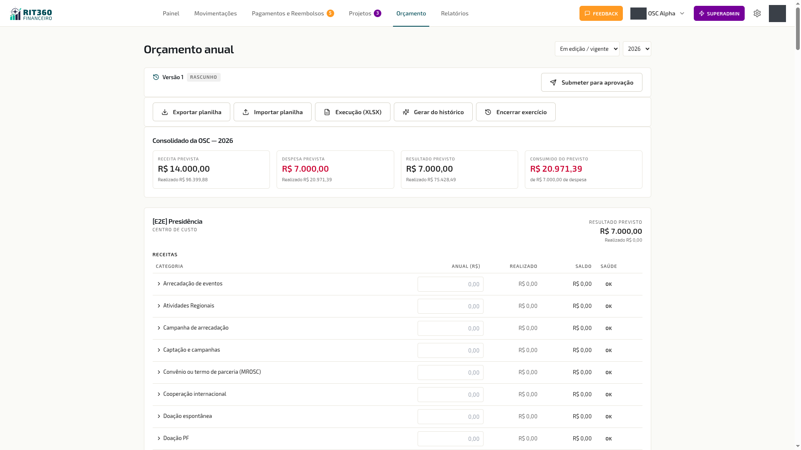
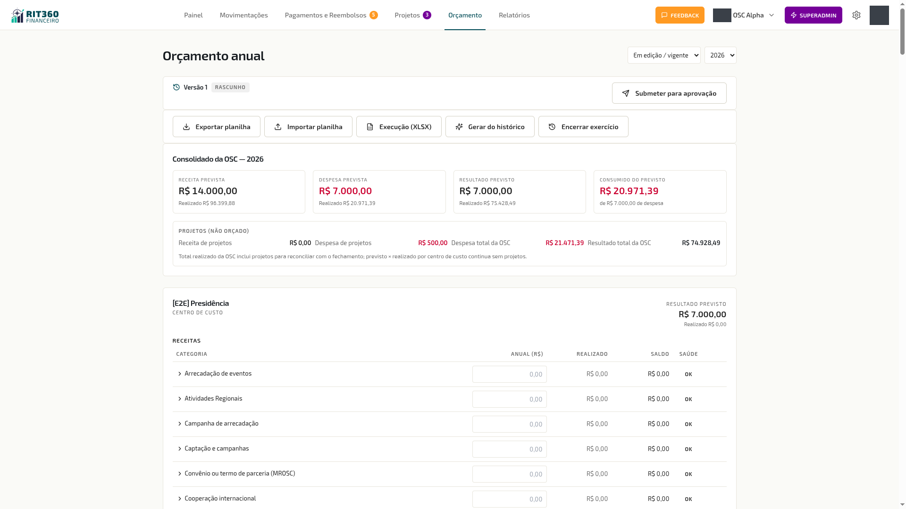
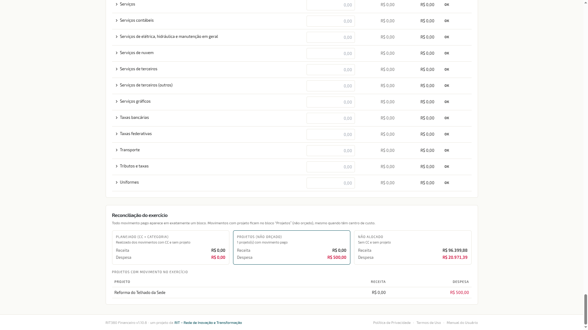

O módulo de **Orçamento** é onde a OSC monta o seu **orçamento anual** — quanto pretende arrecadar e quanto pretende gastar ao longo do ano, organizado por **centro de custo** e por **categoria** — e depois acompanha, mês a mês, o **previsto contra o realizado**. É a ferramenta que transforma "a gente vai vendo como fica" em "a gente combinou onde queria chegar e sabe, a qualquer momento, se está no caminho".

> Acesse pelo menu **Orçamento**.

> 💡 **Por que isso importa**
>
> A maioria das OSCs sabe quanto gastou — mas só *depois*. O orçamento anual inverte isso: no começo do ano a diretoria decide **onde quer investir** e **quanto cada área pode gastar**, e ao longo dos meses o sistema mostra quem está dentro, quem está apertado e quem já estourou. Sem orçamento, o pedido "podemos gastar mais R$ 2.000 no projeto X?" não tem resposta objetiva. Com orçamento, tem: dá para ver o quanto do previsto para aquele centro de custo já foi consumido, e decidir com número na mão. É planejamento e prestação de contas no mesmo lugar.

## Conceitos essenciais

> 📖 **Conceito · Orçamento é bússola, não cadeado**
>
> O RIT360 Financeiro **alerta, não bloqueia**. Passar do previsto num centro de custo ou categoria não trava lançamentos, não impede pagamentos, não cancela nada. O sistema mostra o sinal (amarelo, vermelho), avisa quem precisa saber e deixa a decisão com as pessoas. A vida da OSC é imprevista — surge uma emergência, um financiador atrasa, um custo dobra. O orçamento serve para você **enxergar** isso cedo e agir, não para ser um muro que atrapalha o trabalho. É bússola, não cadeado. (E não é um ERP: não emite nota, não controla estoque — é planejamento financeiro anual.)

> 📖 **Conceito · Previsto × Realizado**
>
> **Previsto** é o que você planejou no início do ano: "vamos arrecadar R$ 120.000 e gastar R$ 30.000 com o centro de custo Administração". **Realizado** é o que de fato aconteceu, calculado a partir das movimentações registradas. A graça do módulo está em ver os dois lado a lado, a qualquer momento: previsto para o ano, realizado até agora, e o quanto disso já foi consumido em percentual.

> 📖 **Conceito · Baseline (linha de base)**
>
> Quando um orçamento é aprovado, ele vira o **baseline** — a versão "oficial" e congelada contra a qual todo o acompanhamento é feito. Depois de virar baseline, ele não muda sozinho: qualquer alteração passa por uma **revisão** com motivo registrado. Isso garante que o "previsto" que você compara com o realizado é sempre o número que a diretoria de fato aprovou, e não algo editado no meio do caminho sem ninguém saber.

> 📖 **Conceito · Linha de contingência**
>
> Além das receitas e despesas planejadas, cada centro de custo pode ter uma **linha de contingência** — uma reserva para o imprevisto daquela área. É a forma honesta de orçar: em vez de fingir que nada vai sair do script, você separa uma folga explícita. Quando o imprevisto chega, ele consome a contingência (que estava prevista), em vez de estourar o orçamento de surpresa.

## O ciclo do orçamento

O orçamento passa por quatro fases ao longo do ano:

| Fase | O que acontece |
|---|---|
| 📝 **Elaborar** | Montar o orçamento do ano — receitas e despesas previstas por centro de custo e categoria |
| ✅ **Aprovar** | A diretoria aprova; o orçamento vira o **baseline** congelado |
| 📊 **Acompanhar** | Ao longo do ano, comparar o previsto com o realizado e agir sobre os alertas |
| 🔒 **Fechar** | No fim do exercício, reconciliar tudo e **encerrar o ano**, guardando o histórico |

As seções a seguir seguem essa ordem.

## Elaborar o orçamento

*Elaboração do orçamento anual — receitas e despesas previstas por centro de custo e categoria*

Para montar um orçamento:

1. No menu, abra **Orçamento**.
2. Escolha o **ano** do orçamento (o ano seguinte, tipicamente, montado nos últimos meses do ano corrente).
3. Lance as **receitas previstas** — o que a OSC pretende arrecadar — e as **despesas previstas** — o que pretende gastar — cada linha vinculada a um **centro de custo** e a uma **categoria**.
4. Para cada linha, informe o **valor anual**. O sistema **distribui automaticamente** esse valor pelos 12 meses (divisão igual), e você pode **ajustar mês a mês** quando o gasto não é uniforme — por exemplo, concentrar a despesa de um evento no mês em que ele acontece.
5. Se quiser, adicione a **linha de contingência** de cada centro de custo (a reserva para imprevistos daquela área).
6. Para tirar linhas do rascunho, use **Remover linha**. O sistema pede confirmação mostrando a categoria e o valor anual. Para várias de uma vez, marque as linhas (há **selecionar todas** em cada centro de custo) e use **Remover selecionadas**. A confirmação diz quantas linhas e o total anual que sai, e o resultado separa as removidas das recusadas.
7. Acompanhe, no rodapé, o **resultado previsto** — a diferença entre o total de receitas e o total de despesas previstas, indicando **superávit** (sobra) ou **déficit** (falta) planejado para o ano.

> 💡 **Distribuir por 12 e ajustar depois**
>
> Comece sempre pelo valor anual — é mais fácil pensar "vamos gastar uns R$ 24.000 no ano com o aluguel" do que preencher 12 campos. O sistema divide em R$ 2.000/mês. Só então você ajusta os meses que fogem do padrão: o 13º do funcionário em dezembro, a taxa anual que cai em março, o gasto do evento em setembro. O resto pode ficar na média.

### Verba do ano em valor único
{: #verba-do-ano-valor-unico }

Para um centro de custo que não precisa de detalhe, dá para definir **uma verba do ano só**, sem escolher categoria nem mês. Na área do centro, no campo **Verba do ano (valor único)**, informe o valor e salve. Zerar o valor remove a verba.

Quem pode elaborar o orçamento daquele centro grava a verba, e só enquanto a versão está em **rascunho** e o ano está aberto.

> ✓ **Dica · Quando a verba única basta**
>
> Serve para uma área que não precisa de controle por categoria nem por mês — um núcleo, uma seção, uma unidade com um valor combinado para o ano. Se a área passar a precisar de detalhe, você detalha depois, com as regras abaixo.

Algumas regras para a verba única:

- **Vale só depois da aprovação**, como as demais linhas do orçamento. Uma revisão do orçamento copia a verba junto com as linhas.
- **Um centro usa verba única ou linhas detalhadas, nunca os dois.** Se o centro tem verba única e você decide detalhar por categoria e mês (botão **Detalhar por categoria e mês**), a tela avisa antes que a verba passará a ser a soma das linhas e que o valor único deixa de valer naquela versão. Enquanto você não preencher nenhuma linha, a verba continua como está.
- **Conta uma vez só nos totais.** O total da organização, o fechamento e o relatório de execução somam a verba do centro uma única vez.
- **Não aparece mês a mês.** A verba única vale para o ano inteiro e não entra na visão do previsto mês a mês.
- **Na planilha**, há uma aba própria, **Verba sem categoria**. A importação de volta não lê essa aba: a verba única é definida na tela do Orçamento.

### Gerar automaticamente a partir do histórico

Quando a sua OSC já tem **pelo menos dois anos** de movimentações registradas, o módulo oferece a opção **Gerar automaticamente**: em vez de partir da folha em branco, o RIT360 Financeiro monta um rascunho do orçamento baseado no que a OSC de fato arrecadou e gastou nos anos anteriores, por centro de custo e categoria. Você recebe uma base realista e só ajusta o que mudou — muito mais rápido do que digitar tudo do zero.

> ✓ **Dica · Gere, depois questione linha por linha**
>
> A geração automática é um ótimo ponto de partida, não a palavra final. Ela repete o passado; o seu trabalho é decidir o que muda no ano que vem — o projeto novo que entra, a fonte de recurso que acaba, a economia que você quer fazer. Gere o rascunho, e então percorra cada linha perguntando "isso ainda faz sentido para o ano que vem?".

### Montar com o assistente

Em vez de começar da folha em branco, a tela do Orçamento tem um assistente que monta uma proposta do ano com você. Ele aparece só para quem elabora o orçamento da organização inteira, como Presidente e Tesoureiro (ver [Papéis e Permissões](/papeis/)), e só enquanto a versão do ano está em **rascunho**. O Gestor de Centro de Custo, que cuida só da sua área, não vê o assistente. Depois de enviada para aprovação ou aprovada, a versão deixa de mostrá-lo.

> 💡 **Por que isso importa**
>
> Quem monta o orçamento à mão precisa lembrar de tudo o que a OSC gastou e recebeu no ano anterior, e quase sempre esquece alguma coisa. O assistente parte dos lançamentos que a organização já tem, mesmo que sejam poucos meses, e pergunta o que os lançamentos não dizem sozinhos: o que de fato entra, o que tem de ser pago, quais projetos já estão comprometidos. O resultado é uma proposta mês a mês que você revisa, em vez de um formulário para preencher.

#### Passo a passo

1. Abra **Orçamento**, escolha o ano do rascunho e clique em **Montar com o assistente**.
2. Ele lê os lançamentos dos **últimos 12 meses** e diz quantos meses encontrou com movimentação. Lançamentos ligados a **projetos** ficam de fora dessa leitura.
3. Se alguma categoria tem histórico incompleto, ele pergunta **uma vez** por categoria o que fazer com os meses sem dado: **repetir a média** nesses meses, **informar outro valor por mês** ou **deixar como estimativa**. Se a mesma resposta vale para todas, use **aplicar a todas**.
4. Responde as perguntas, nesta ordem:
   - **O que entra**: primeiro, as receitas encontradas no histórico, uma a uma. Para cada uma, diga se **continua** (e com que certeza: **garantida**, **provável** ou **incerta**) ou se **não continua**; dá para dar a mesma resposta a todas. Receita que não continua sai da proposta. Receita sem resposta entra como **provável** e aparece marcada **a confirmar**. Depois, informe as fontes novas ou corrija valores: quanto, em quais meses e com que certeza.
   - **O que é obrigatório pagar**.
   - **Projetos comprometidos**.
   - **O que seria bom ter**.
   - **Três perguntas abertas**, para o que ficou de fora.

   Toda pergunta pode ser pulada. Se a organização orça por **centro de custo**, as despesas são informadas por centro.
5. Revise a proposta em cinco blocos: **receitas**, **obrigatórias**, **projetos**, **desejáveis** e **resumo**. Em cada linha dá para mudar o **valor anual** direto: os meses se ajustam mantendo a proporção entre eles, e o resumo recalcula na hora. Para acertar um mês específico, use **Editar meses**. Depois de aplicar, as linhas continuam editáveis no rascunho, inclusive mês a mês, até o orçamento ser enviado para aprovação.
6. Escolha como aplicar ao rascunho e confirme.

**Como a proposta se fecha.** Cada despesa é classificada como **essencial**, **importante** ou **desejável**. Só receita **garantida** e **provável** conta no total; receita **incerta** fica à parte. Se as despesas não cabem no que entra, a proposta mostra quanto falta e o que sairia: primeiro as **desejáveis**, depois as **importantes**. Despesa **essencial** nunca é cortada automaticamente.

**De onde veio cada valor.** Cada linha diz se o valor veio do **histórico**, da sua **resposta** ou de uma **estimativa**. Estimativas aparecem marcadas como "estimativa, confira". Se você editar a linha, essa marcação some, mesmo que o valor continue sendo estimativa.

**Se o rascunho já tem linhas**, você escolhe entre:

- **Substituir**: a proposta toma o lugar das linhas do rascunho. A reserva de contingência é mantida.
- **Só acrescentar**: entram apenas as linhas que ainda não existem no rascunho.

**Aplicar grava no rascunho.** A proposta não é enviada para aprovação: o envio continua sendo seu, e o fluxo de aprovação segue igual. Se alguma linha for recusada, **nada é gravado**.

> ✓ **Dica · Pule o que não sabe**
>
> Pular uma pergunta é válido, e dá para fechar o assistente e retomar depois. O que faltar aparece como estimativa, marcada na revisão, para você conferir antes de aplicar.

> ✓ **Dica · Responda antes de gerar**
>
> Cada proposta gerada consome uma unidade da cota mensal de uso do assistente da organização. Responda as perguntas com calma e revise o resultado, em vez de gerar uma proposta nova a cada ajuste. (Ver [Assistente com IA](/modulos/assistente/).)

> ⚠️ **Atenção · Mês sem lançamento não é zero**
>
> Um mês sem movimentação no histórico **não** entra como gasto zero. Se a organização tem poucos meses de lançamento, a média sai só desses meses. Confira a quantidade de meses que o assistente informa antes de aceitar a média.

> ⚠️ **Atenção · Receita incerta não fecha o orçamento**
>
> Uma receita marcada como **incerta** não entra no total. Se as despesas não couberem, a proposta mostra o que sairia. Marque como **provável** só o que a organização de fato espera receber.

> ⚠️ **Atenção · Substituir troca o que já estava no rascunho**
>
> Se você já montou parte do orçamento à mão, prefira **só acrescentar**. Substituir traz a proposta no lugar das linhas que estavam no rascunho. A reserva de contingência é mantida.

> 📖 **Conceito · O que vai para o serviço de IA**
>
> Vão apenas **totais por categoria, centro de custo e mês**, e as respostas que você deu. **Nomes, descrições de lançamentos e documentos não são enviados.** A [Política de Privacidade](/privacidade/) descreve os provedores de IA usados pelo sistema.

## Acompanhar: previsto × realizado

*Acompanhamento — semáforo de saúde por centro de custo e categoria, previsto contra realizado*

Depois de aprovado, o orçamento vira painel de acompanhamento. Para cada **centro de custo** e cada **categoria**, você vê o previsto para o ano, o realizado até agora e um **semáforo de saúde**:

- 🟢 **Verde** — dentro do previsto, folga confortável.
- 🟡 **Amarelo** — consumo alto, chegando perto do limite (passou de **80%** do previsto).
- 🔴 **Vermelho** — estourou o previsto (passou de **100%**).

O semáforo deixa a diretoria enxergar de relance onde está o aperto, sem abrir linha por linha — e agir a tempo, não no fim do ano.

Para acompanhar uma área específica, use a tela [Minha área](/modulos/minha-area/): ela junta, para um centro de custo e um ano, a verba, o gasto, o comprometido e o saldo.

> 📖 **Conceito · De que centro de custo é o gasto de um projeto**
>
> Um gasto pode ter um **centro de custo** (a área que responde por ele) e estar ligado a um **projeto** (a iniciativa que o motivou). Para decidir em qual área ele conta no orçamento, o que vale é **a fonte do dinheiro escolhida em cada lançamento** — caixa geral da organização, receitas do próprio projeto (festa, bazar, doação) ou financiador (edital, convênio, termo de fomento, patrocínio):
>
> - **Lançamento sem projeto** — conta no centro de custo do lançamento, como sempre.
> - **Lançamento de projeto com fonte de caixa geral** — conta no **centro de custo do lançamento** (ou nos centros, se o custo foi repartido). Sem centro de custo, vai para **Não alocado**. Assim, o orçamento de cada área reflete o dinheiro que ela de fato usou.
> - **Lançamento de projeto com fonte de financiador ou de receitas próprias** — fica no **orçamento do projeto**, fora do centro de custo.
> - **Lançamento de projeto sem fonte escolhida** — se o projeto só tem fonte de caixa geral, ou não tem fonte nenhuma, conta no centro de custo, como um lançamento sem projeto (sem centro de custo, vai para **Não alocado**). Se o projeto tem financiador ou receitas próprias, fica no orçamento do projeto.
>
> Um projeto **misto** (parte com caixa geral, parte com convênio, por exemplo) é separado **lançamento a lançamento**: cada gasto segue a fonte que ele tem. Cada lançamento conta em **um lugar só**, e o total da organização não muda — o que muda é em qual área o gasto aparece. A mesma regra vale para os alertas, para o histórico do orçamento e para o assistente do orçamento.
>
> 💡 **Dica · O que decide é a fonte do lançamento**
>
> Não é o projeto, sozinho, que decide. Se um gasto de convênio aparecer na sua área, confira a **fonte escolhida no lançamento**: com caixa geral, ele conta aqui; com o financiador, ele sai desta área e aparece no orçamento do projeto.

## Aprovar e revisar

O orçamento tem um ciclo de aprovação parecido com o dos demais fluxos da OSC:

| Status | Significado |
|---|---|
| 📝 **Rascunho** | Em elaboração — livremente editável, ainda não é o baseline |
| 🟡 **Em aprovação** | Enviado; aguardando o voto dos aprovadores elegíveis |
| 🟢 **Aprovado** | Vira o **baseline** congelado; passa a valer para o acompanhamento |

Enquanto está em **rascunho**, você edita à vontade. Ao enviar para **aprovação**, os aprovadores configurados decidem. Uma vez **aprovado**, o orçamento congela como baseline.

> ✓ **Dica · O selo diz "Vigente" ou "Anterior", não o nome técnico da versão**
>
> Ao navegar entre as versões aprovadas de um mesmo orçamento (por exemplo, depois de uma revisão), o selo ao lado de cada uma mostra **Vigente** (a que vale para o acompanhamento hoje) ou **Anterior** (a que foi substituída). Antes disso o selo trazia um identificador técnico de versão, que não dizia nada para quem só quer saber qual número está valendo agora.

### Revisar um orçamento aprovado

A vida muda ao longo do ano, e às vezes o orçamento precisa mudar junto — entrou uma verba nova, um projeto foi cancelado, um custo disparou. Para isso existe a **revisão**:

- Toda revisão **exige um motivo**, que fica registrado na trilha de auditoria. Não dá para mexer no baseline sem dizer por quê.
- Ajustes **pequenos** (abaixo de um limiar configurável pela OSC) são aplicados direto.
- Ajustes **acima do limiar** voltam para **aprovação** — a diretoria precisa concordar de novo antes de o novo número valer.
- Uma revisão **copia as verbas de valor único** junto com as linhas do orçamento (ver [Verba do ano em valor único](#verba-do-ano-valor-unico)).

> 📖 **Conceito · O limiar de revisão**
>
> O **limiar** é o tamanho de mudança que a OSC considera "grande o bastante para precisar de nova aprovação". Ele é configurável (ver [Configurações → Fluxo de Aprovações → aba Orçamento](/configuracoes/aprovacoes/#aba-orcamento)). A ideia: correções pequenas — arredondar uma linha, remanejar R$ 200 entre categorias — não deveriam parar o trabalho de todo mundo esperando aprovação. Já uma mudança grande — cortar 20% do orçamento de uma área, dobrar a previsão de uma despesa — muda o combinado com a diretoria e merece um novo "sim" formal. O limiar é onde a sua OSC traça essa linha.

## Fechar o exercício

*Reconciliação — planejado, projetos e não alocado, antes de encerrar o exercício*

No fim do ano, o orçamento tem uma visão de **reconciliação** que junta as três origens do que foi realizado:

- **Planejado** — o realizado que caiu nos centros de custo e categorias que você orçou. Inclui o gasto dos lançamentos de projeto pagos com caixa geral, pelo centro de custo de cada lançamento.
- **Projetos com financiador ou receitas próprias** — o realizado dos lançamentos pagos com financiador ou receitas do próprio projeto, que têm orçamento próprio e não passam pelo centro de custo.
- **Não alocado** — movimentações que aconteceram fora do que foi orçado, sem centro de custo ou categoria previstos (inclusive o gasto de projeto pago com caixa geral que ficou sem centro de custo).

A reconciliação fecha a conta: mostra que a soma das partes bate com o total de fato movimentado no ano, sem sobra nem furo.

Quando o ano acaba e a prestação de contas está pronta, você usa **Encerrar o exercício**: o orçamento é **congelado** definitivamente e guardado como histórico. Fica disponível para consulta e comparação, mas não é mais editado.

> ⚠️ **Atenção · Encerrar o exercício é definitivo**
>
> Encerrar o ano congela o orçamento como registro histórico — depois disso ele não é mais editável. Faça o encerramento só quando o ano estiver de fato fechado (todas as movimentações registradas, a prestação de contas concluída). Antes disso, mantenha o orçamento aberto para acompanhar e revisar normalmente.

## Relatórios e planilha

O módulo conversa com planilhas e relatórios para caber no fluxo que a sua OSC já usa:

- **Exportar e importar em XLSX** — leve o orçamento para uma planilha (Excel, Google Sheets) para trabalhar offline, discutir com a diretoria ou preparar em conjunto, e depois **importe de volta**. Útil para OSCs que montam o orçamento em reunião, na planilha, antes de oficializar no sistema. A verba de valor único vem numa aba própria, **Verba sem categoria**, que a importação não lê (ver [Verba do ano em valor único](#verba-do-ano-valor-unico)).
- **Relatório de execução** — um relatório do previsto × realizado do ano, exportável em **PDF** (para anexar à prestação de contas ou enviar a financiadores) e em **Excel** (para análise).
- **Execução por Centro de Custo na prestação de contas** — a prestação de contas da OSC ganhou uma seção **"Execução por Centro de Custo"**, mostrando, para cada área, o previsto, o realizado e o quanto foi consumido. Ver [Relatórios → Exportação](/modulos/relatorios/#exportação).

## Alertas automáticos

O RIT360 Financeiro avisa **sozinho** quando um centro de custo ou categoria passa dos limites do previsto:

- Ao ultrapassar **80%** do previsto — aviso de que o consumo está alto (semáforo amarelo).
- Ao ultrapassar **100%** do previsto — aviso de que estourou (semáforo vermelho).

Os avisos vão para o **gestor do centro de custo** (quem responde por aquela área) e para o **tesoureiro** (quem cuida do financeiro consolidado) — as duas pessoas que precisam decidir o que fazer. Você não precisa ficar olhando o painel todo dia: o sistema chama a sua atenção quando algo pede atenção.

> 💡 As preferências de canal (e-mail, no app) desses avisos seguem as configurações de notificação de cada pessoa, em [Meu Perfil](/configuracoes/perfil/).

> ⚠️ **Atenção · A verba de valor único ainda não entra nos avisos por e-mail**
>
> Os avisos de 80% e 100% por e-mail ainda não consideram a verba definida em valor único. Para um centro com verba única, acompanhe o limite na tela [Minha área](/modulos/minha-area/), que mostra o aviso perto do limite e ao passar dele.

## Quem pode o quê

O acesso ao orçamento acompanha os papéis financeiros da OSC:

| Papel | No orçamento |
|---|---|
| **Presidente** | Elabora, revisa, aprova e encerra — tudo, em todos os centros de custo |
| **Tesoureiro** | Elabora e revisa — tudo, em todos os centros de custo |
| **Gestor de Centro de Custo** | Elabora e acompanha **apenas o(s) seu(s) centro(s) de custo**, inclusive a verba de valor único deles |
| **Diretor, Comissão Fiscal, Coordenador, Voluntário** | **Veem** o orçamento (dentro do seu nível de acesso ao financeiro), mas não elaboram |

A tela [Minha área](/modulos/minha-area/) aparece para quem responde por algum centro de custo e para quem tem permissão de ver o orçamento. Quem vê o orçamento enxerga todos os centros; o Gestor de Centro de Custo, só os seus.

- **Ver** o orçamento é amplo: todos com acesso ao financeiro enxergam o previsto × realizado, cada um dentro do recorte que já têm (o Gestor de Centro de Custo vê o seu CC; os demais, conforme o seu papel).
- **Elaborar e gerenciar** cabe a quem opera o financeiro: Presidente e Tesoureiro no consolidado; o Gestor de Centro de Custo, restrito à sua área.
- **Aprovar** depende da permissão de aprovação de orçamento (`budget.approve`), configurada em [Fluxo de Aprovações → aba Orçamento](/configuracoes/aprovacoes/#aba-orcamento).

Ver [Papéis e Permissões](/papeis/) para o quadro completo.

## Boas práticas

> ✓ **Dica · Monte o orçamento do ano que vem em novembro**
>
> Não deixe para janeiro. Nos últimos meses do ano você já tem quase o ano fechado como base, sabe o que arrecadou e gastou, e consegue projetar o próximo com dados reais. Use **Gerar automaticamente** (se tiver dois anos de histórico), ajuste para o que muda, e leve para a diretoria aprovar antes de o ano começar. Assim janeiro já começa com bússola.

> ✓ **Dica · Contingência de verdade, não zero**
>
> Orçamento sem contingência é orçamento que vai estourar. Toda OSC tem imprevisto — um equipamento que quebra, um custo que sobe, uma oportunidade que aparece. Reserve uma linha de contingência por centro de custo (uma folga de 5% a 10% do previsto costuma ser saudável). É mais honesto orçar a folga do que fingir que ela não existe e depois explicar o "estouro".

> ⚠️ **Atenção · Revisar não é apagar o histórico**
>
> Quando você revisa o orçamento, o motivo fica registrado e o baseline anterior não some — a trilha mostra o que mudou, quando e por quê. Isso protege a OSC: numa auditoria ou prestação de contas, dá para explicar cada ajuste. Não veja a exigência de motivo como burocracia; é o que faz o orçamento ser levado a sério.

## Por onde seguir

- [**Movimentações**](/modulos/movimentacoes/) — de onde vem o "realizado" que o orçamento acompanha.
- [**Projetos**](/modulos/projetos/) — onde os gastos de projeto são orçados e acompanhados. Em qual centro de custo cada gasto de projeto conta está explicado no conceito "De que centro de custo é o gasto de um projeto", na seção **Acompanhar: previsto × realizado**.
- [**Minha área**](/modulos/minha-area/) — a verba, o gasto e o saldo de um centro de custo, numa tela só.
- [**Relatórios**](/modulos/relatorios/) — o relatório de execução e a prestação de contas com Execução por Centro de Custo.
- [**Configurações → Fluxo de Aprovações → aba Orçamento**](/configuracoes/aprovacoes/#aba-orcamento) — quem aprova, quórum, limiar de revisão e alertas.
- [**Papéis e Permissões**](/papeis/) — quem vê, quem elabora e quem aprova o orçamento.
